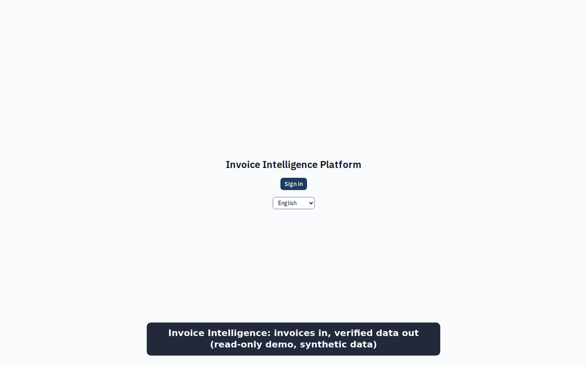
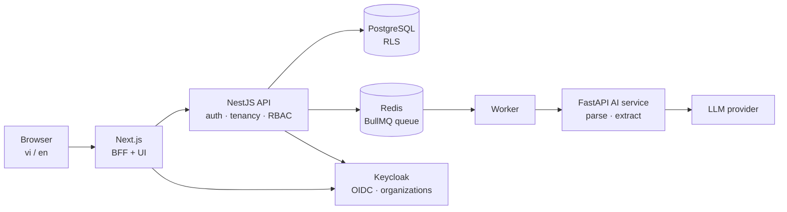

# Invoice Intelligence Platform *(working name)*

Small businesses in Vietnam receive invoices as e-invoice XML, PDFs and phone photos, and someone retypes them into the books. This multi-tenant web app turns each one into **structured, checked data**: XML is parsed exactly; PDFs and photos are read by a vision LLM whose answer is validated against a schema and business rules, then **approved by a person** next to the original. Vietnamese and English.

Built by one developer with an AI coding agent, under a test-gated workflow ([How I used AI](#how-i-used-ai-draft)).



*Recorded on 2026-11-10 from the production build running locally in read-only demo mode; every invoice is synthetic. No public link yet: the free cloud host I planned for refused the sign-up, so hosting is postponed. [Run it locally](#run-it-locally) instead.*

## What it does

| Input | Processing | Output |
|---|---|---|
| Vietnamese e-invoice **XML** | Deterministic parser, XXE-safe, no AI | Structured invoice, exact |
| **PDF / photo** (vi or en) | Photo turned upright (EXIF) and metadata stripped → vision LLM constrained by a JSON Schema → schema validation → business rules | Structured invoice, per-field confidence and evidence, warnings |
| A person | Review screen: original beside the form, click a field to see where it was read | Approved invoice, every correction recorded |

Questions over the invoices with cited sources (RAG) come in the next milestone.

## Measured results

Extraction on a **fixed set of 100 synthetic invoices** (9 variants: clean PDFs, many lines, multi-page, tilted, noisy and low-resolution photos), model `gemini-3.5-flash-lite`, measured 2026-11-09:

| Metric | Result |
|---|---|
| Invoices with all 8 critical fields right (number, series, date, currency, subtotal, total, both tax codes) | **93 / 100** |
| Whole invoice exactly right, every field and line | 85 / 100 |
| Line items, F1 | 0.983 |
| Latency per document, p50 / p95 | 4.6 s / 12.5 s |
| Cost per document at list price / **actually paid** | $0.0045 / **$0** (free tier, no billing account) |
| Prompt-injection sentences hidden in invoices that changed a value | 0 of 24 |

The other candidate, `gemini-3.1-flash-lite`, had all 8 critical fields right on 85 / 100. Invoice by invoice, it won on 2 and lost on 10. It is cheaper ($0.0028 a document at list price) but slower in the tail (p95 22.9 s). Sources: [model comparison](eval/reports/compare-v1.md) with the [hand-written analysis](eval/reports/compare-v1.analysis.md), [full report](eval/reports/v1-gemini-3.5-flash-lite-invoice_extraction-v1.md), thresholds in [ADR 0020](docs/architecture/adr/0020-eval-thresholds.md).

**Known limits**

- Synthetic invoices are cleaner than real scans, so these scores are an upper bound.
- The worst error is silent: the seller's tax code loses its branch suffix (`…-891`) on 7 of the 26 invoices that print one, with the model reporting high confidence. The review screen does not yet catch it.
- Invoices longer than about 86 lines exceed the output-token cap and are rejected.

## Architecture



- **Tenant isolation that survives a missing `WHERE`:** PostgreSQL Row-Level Security under the application filter, tested against a real database in CI ([ADR 0003](docs/architecture/adr/0003-postgres-rls-tenant-isolation.md), [isolation tests](apps/api/test/tenant-isolation.int-spec.ts)).
- **The LLM is an untrusted component:** one Zod schema drives the form, the API and the model output ([ADR 0004](docs/architecture/adr/0004-contracts-zod-json-schema.md)); rules re-check the arithmetic; a person approves; the provider sits behind an interface ([ADR 0009](docs/architecture/adr/0009-llm-provider-gemini.md)).
- **Two languages on purpose:** TypeScript for the web and the API; Python for the stateless AI service, where the PDF and LLM libraries are ([ADR 0002](docs/architecture/adr/0002-python-ai-service.md)).
- **Asynchronous pipeline:** upload → queue with retries and backoff → worker → AI service, idempotent per document ([ADR 0008](docs/architecture/adr/0008-queue-bullmq.md)).
- **Read-only demo build:** writes refused by a guard and by a read-only database transaction, no LLM reachable ([ADR 0018](docs/architecture/adr/0018-public-demo-read-only.md)).

Details: [Architecture](docs/architecture/ARCHITECTURE.md) · [Data model](docs/architecture/DATA_MODEL.md) · [API](docs/architecture/API.md) · [AI pipeline](docs/architecture/AI_PIPELINE.md) · [Security](docs/architecture/SECURITY.md) · [20 ADRs](docs/architecture/adr/README.md)

**Stack:** Next.js · React · TypeScript · NestJS · Drizzle · Python/FastAPI · PostgreSQL · Redis/BullMQ · Keycloak · Docker · GitHub Actions · Playwright (pgvector joins with Q&A)

## How I used AI *(draft)*

Most of the code was written by an AI coding agent (Claude Code); I decide, review and must be able to explain every part. The loop for each of the tasks in the [plan](docs/plan/ROADMAP.md):

1. **Spec first.** Each task has scope, out-of-scope and checkable "done when" items, written before the code.
2. **Plan, then approve.** The agent proposes files, approach and a rejected alternative, checked against the ADRs; I approve or send it back.
3. **Evidence, not claims.** It must paste the output of every check; tests run real code (real Postgres, real browser), and every new automated check is shown failing once on bad input, to prove it can fail.
4. **Second opinion.** A fresh-context reviewer agent reads the diff; a security auditor joins for auth, upload and LLM work.
5. **Comprehension gate.** I answer three concept questions without the code before a task is marked done, then log what I learned and where the agent was wrong.

Agent mistakes caught by this process, from the [learning log](docs/learning-log.md):

- The demo plan only removed the account page, but a rehearsal showed a Keycloak URL (`kc_action=UPDATE_PASSWORD`) still let a signed-in visitor change the shared demo password. Fixed by disabling account actions (T4.7).
- A first plan forwarded the browser's `X-Forwarded-For` to an API that trusted it, so users could choose the IP written to the audit log. The reviewer caught it (T2.10).
- The agent wrote the wrong cause for a failed invoice into an ADR, three schema errors; the stored output showed the JSON had been cut at the token cap, which became its own task (T4.4, T4.5b).

## Legal & data policy

- **Synthetic data only**, in code, tests, prompts, screenshots and the demo: invoices from [`tools/invoice-gen`](tools/invoice-gen/README.md) with a fixed seed, tax codes with **invalid check digits**, `SAMPLE` names and a `SAMPLE – SYNTHETIC DATA` watermark.
- **$0 running cost:** Gemini free tier without a billing account (the free tier lets Google use inputs, which is why only synthetic data is ever sent), self-hosted open-source services.
- Libraries are limited to an allow-list of licences; exceptions are reviewed one by one.
- The read-only demo build accepts no uploads, makes no LLM calls and so collects no personal data from visitors.

Details: [LEGAL.md](docs/LEGAL.md)

## Run it locally

Needs Linux or WSL2 with Docker, Node ≥ 24, pnpm and uv ([setup](docs/setup/WSL2.md)).

```bash
git clone https://github.com/conghau113/invoice-intelligence-platform.git
cd invoice-intelligence-platform
pnpm install
LLM_PROVIDER=fake pnpm dev:stack   # infra + migrations, then AI :8000, API :3001, worker, web :3000
```

Open http://localhost:3000 and sign in with a [demo account](docs/setup/DEMO_ACCOUNTS.md): `accountant@acme.example`, password `demo-dev-only` (local stack only), uploads and approves. `LLM_PROVIDER=fake` returns one canned invoice for every PDF or photo; to read the real file, drop it and put a free Gemini API key in `GEMINI_API_KEY` in the env file of `apps/ai` (variables listed in its example env file). XML needs no key. The read-only production stack: [`infra/prod`](infra/prod/README.md).

## Status and docs

Milestones M0 to M4 (of M0–M8) are implemented: monorepo and CI, login with tenants and roles, upload and the XML pipeline, LLM extraction and review, accuracy measurement and the read-only demo build. Next: Q&A with citations, rate limiting and realtime, observability, deployment. [Roadmap](docs/plan/ROADMAP.md) · [Task ledger](docs/plan/TASKS.md) · [Project overview](docs/PROJECT_OVERVIEW.md) ([Tiếng Việt](docs/PROJECT_OVERVIEW.vi.md)) · [PRD](docs/product/PRD.md) · [NFR](docs/product/NFR.md)
