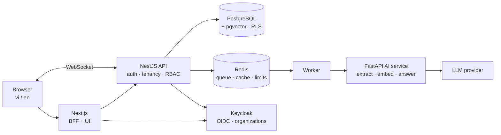

# Invoice Intelligence Platform — Project Overview

> *Working name.* A multi-tenant SaaS that turns invoices (Vietnamese e-invoice XML, PDFs, photos) into verified, searchable data, and answers questions about them with cited sources. Built end-to-end by one developer, Nguyen Cong Hau, with an AI coding agent under a documented, test-gated workflow.
>
> 🇻🇳 Tiếng Việt: [PROJECT_OVERVIEW.vi.md](PROJECT_OVERVIEW.vi.md)

**Status:** planning complete, implementation starting. Every number marked *target* becomes a measured value with a linked report as milestones finish.

---

## What it does

| Input | Processing | Output |
|---|---|---|
| E-invoice **XML** (Vietnam mandates XML for e-invoices — Decree 123/2020, Art. 12.1) | Deterministic parser, XXE-safe | Structured invoice, exact |
| **PDF / photo** of an invoice or receipt (any language) | Vision LLM constrained by a JSON Schema → validation → business rules | Structured invoice + per-field confidence + warnings |
| A **question** in Vietnamese or English ("How much did we pay ACME in Q3?") | Question routing → hybrid retrieval (vector + full-text) or a validated structured query → answer generation | Answer with **citations** to source invoices, or "I don't know" |

Around that core: human review and approval, realtime progress, role-based access, strict tenant isolation, quality metrics for the AI, and full observability.

## Why it is a non-trivial system

- **Multi-tenancy that survives mistakes** — PostgreSQL Row-Level Security under an application filter; a forgotten `WHERE` returns nothing instead of another company's data. Proven by isolation tests in CI.
- **AI treated as an unreliable component** — schema-constrained output, business-rule checks, human approval, measured accuracy on a fixed dataset, cost per document tracked, provider swappable.
- **Asynchronous, failure-tolerant pipeline** — queue with retries, backoff with jitter, provider 429 handling, circuit breaker, idempotent processing, failure drills.
- **Security for LLM features** — direct and indirect prompt-injection tests, citation verification, no SQL written by the model, PII-free logs.
- **Observable** — one OpenTelemetry trace from the browser through Next.js, NestJS, the queue, and the Python AI service.

## Architecture

Full details: [Architecture](architecture/ARCHITECTURE.md) · [Data model](architecture/DATA_MODEL.md) · [API](architecture/API.md) · [AI pipeline](architecture/AI_PIPELINE.md) · [Security](architecture/SECURITY.md) · [Legal](LEGAL.md) · [ADRs](architecture/adr/README.md)

## Tech stack and why

| Area | Choice | Why (ADR) |
|---|---|---|
| Web | Next.js (App Router), React, TypeScript, Tailwind, shadcn/ui, TanStack Query, React Hook Form + Zod, next-intl | SSR + server-side session (BFF, 0006); i18n with ICU messages (0007) |
| API | NestJS, Drizzle ORM | Modular DI; SQL-transparent ORM for RLS and vectors (0016) |
| AI service | Python, FastAPI, pydantic, pypdfium2 | Best ecosystem for documents and LLMs (0002) |
| Contracts | Zod → JSON Schema → pydantic | One schema for form, API and LLM output (0004) |
| Identity | Keycloak (one realm, Organizations) | Enterprise-grade OIDC, tenants as data (0005) |
| Data | PostgreSQL 17 + pgvector, Redis | RLS isolation (0003); vectors next to data (0011) |
| Async | BullMQ on Redis | Retries, limiter, fits Redis already in use (0008) |
| Realtime | Socket.IO (+ Redis adapter), SSE for streaming answers | Trade-off vs FCM recorded (0014) |
| Reliability | Token-bucket rate limiting, cache-aside, circuit breaker | (0012, 0013) |
| Observability | OpenTelemetry → Grafana Cloud | Vendor-neutral tracing across 4 services (0015) |
| Storage | `StoragePort` + local filesystem adapter (S3-compatible adapter optional) | Simple, maintained, swappable (0017) |
| Delivery | Docker (multi-arch amd64/arm64), GitHub Actions, GHCR, Caddy + Let's Encrypt, Oracle Cloud Always Free ARM VM, DuckDNS | €0, real ops skills (0010); read-only public demo (0018) |
| Quality | Vitest, pytest, Testcontainers, Playwright, k6, Lighthouse CI, gitleaks | Behavioural tests against real Postgres; performance and security gates |

## Measured results *(filled in as milestones complete)*

| Metric | Target | Result | Evidence |
|---|---|---|---|
| Cross-tenant leakage in tests | 0 | — | CI |
| Extraction field accuracy (100-doc synthetic set) | set from baseline | — | `eval/reports/` |
| Cost per document | reported | — | `eval/reports/` |
| RAG retrieval hit@5 / citation precision | reported | — | `eval/rag/` |
| API p95 (reads, 20 VUs) | < 300 ms | — | `docs/reports/load-test-v1.md` |
| Core Web Vitals (key pages) | "good" | — | Lighthouse CI |
| Infra cost | €0 | — | — |

## How I used AI

The code is written mostly by an AI coding agent (Claude Code) and reviewed by me. The process is designed so I can explain every part:

1. **Plan before code.** Product, architecture, data model, API, AI pipeline, security, legal notes, 18 ADRs, and a 70-task plan were written, reviewed against public sources, and frozen before implementation.
2. **One task at a time.** Each task has inputs, scope, verifiable "done when" checks and review questions. The agent plans first, I approve, it implements and must show evidence (test output, command results).
3. **Comprehension gate.** After every task I answer review questions without the agent; tasks are not marked done until I can.
4. **Automated gates.** CI checks types, tests (incl. real-database isolation tests), i18n parity, ADR index, docs links, secrets.
5. **Learning log.** What I learned and where the agent was wrong, per task — excerpts below.

*Examples of rejected agent output and agent mistakes will be added here from `docs/learning-log.md`.*

## Roadmap

| Milestone | Outcome |
|---|---|
| M0 | Monorepo, CI, local stack |
| M1 | Login, tenants, roles, vi/en |
| M2 | Upload, document list, end-to-end slice with XML |
| M3 | LLM extraction for PDF/images, review form |
| M4 | Accuracy metrics + read-only public demo |
| M5 | Q&A with citations |
| M6 | Rate limiting, 429 handling, cache, realtime |
| M7 | Observability, security review, continuous deployment |
| M8 | Documentation, demo video |

## Data policy
All invoices in this project are **synthetic** (generated with a fixed seed, invalid tax-code check digits, `SAMPLE` watermark). No real company or personal data is used in code, tests, logs or prompts. The public demo is read-only and calls no LLM. Details: [LEGAL.md](LEGAL.md).
