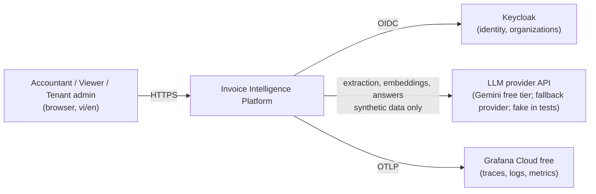
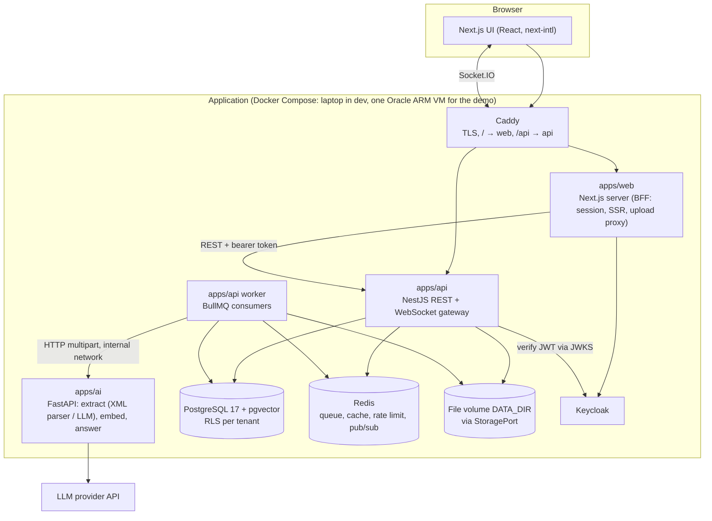
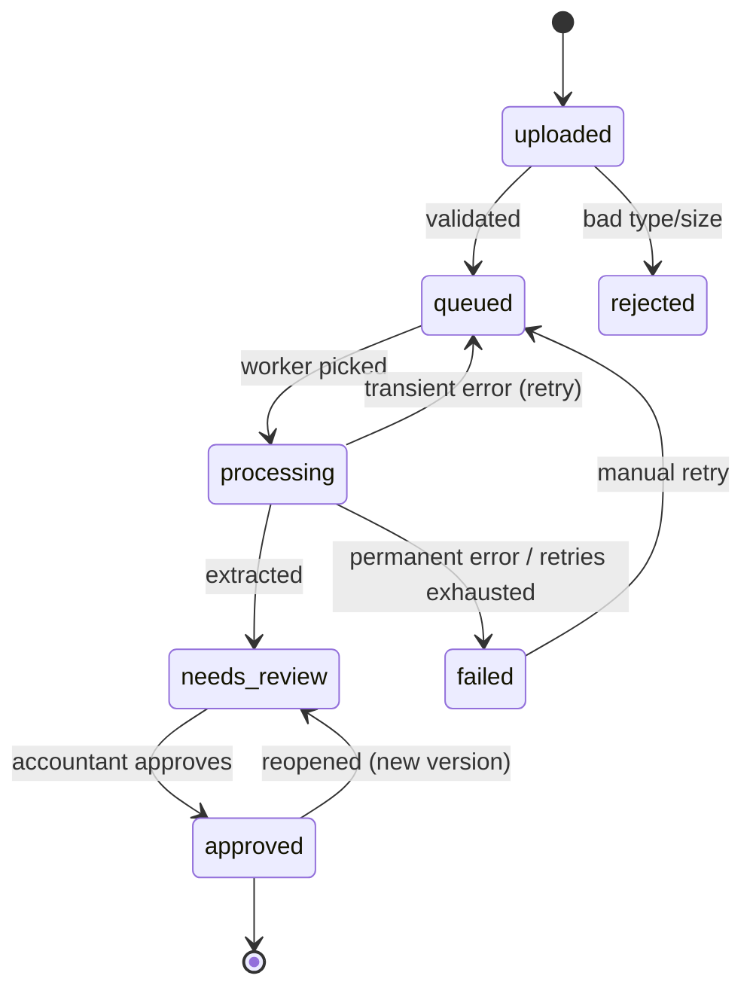

# Architecture

> Status: **Baseline v2 (frozen for implementation, 2026-10-12)**. Changes after freeze require a new or superseding ADR.
> Diagrams use Mermaid so they render on GitHub and stay diff-able.
> Constraint: **zero monetary cost**. Anything that costs money is optional and needs the owner's explicit approval.

## 1. Context

Small and mid-size businesses receive invoices and receipts as Vietnamese e-invoice XML files, PDFs, and phone photos. Someone has to key the data in, check the totals, and later answer questions such as "how much did we pay supplier X last quarter?". This system automates the capture, keeps a human in the loop for approval, and lets users query their own approved data with cited answers.

Non-goals: tax filing, accounting ledger, payments, issuing invoices, mobile apps, processing real customer data.

## 2. System context (C4 level 1)



Keycloak runs inside the same deployment; it is drawn outside the system boundary because it is an off-the-shelf identity provider.

## 3. Containers (C4 level 2)



## 4. Components

| Component | Responsibility | Does NOT do |
|---|---|---|
| `apps/web` (Next.js) | UI, i18n routing, login session (BFF: tokens stay server-side in httpOnly cookies), streams uploads to the API | Business rules that must be enforced; direct DB or file access |
| `apps/api` (NestJS) | Auth (JWT via JWKS), tenancy, RBAC, upload validation, documents, review, Q&A orchestration, rate limiting, realtime gateway, demo read-only mode | Calling LLMs directly; heavy CPU work |
| `apps/api` worker | Queue consumers: extraction, indexing; retries, circuit breaker | Serving HTTP |
| `apps/ai` (FastAPI) | Stateless AI functions: XML parsing, PDF→image, LLM extraction with schema, chunking, embeddings, answers with citations | Persisting data; knowing about users; being reachable from the internet |
| `StoragePort` | Interface for files; `LocalFs` adapter now, SeaweedFS adapter optional (ADR 0017) | — |
| `packages/contracts` | Zod schemas (Invoice, API DTOs), business rules, exported JSON Schema for Python | Runtime I/O |
| PostgreSQL + pgvector | System of record; Row-Level Security; vector + full-text search | — |
| Redis | BullMQ queues, cache, token buckets, Socket.IO adapter | Being a source of truth |
| Keycloak | Users, organizations (tenants), roles, tokens | App permissions beyond roles |
| Caddy | TLS (Let's Encrypt), path routing, security headers | Application logic |

Design patterns used deliberately (and where): **Ports & Adapters** (StoragePort, LLMProvider), **Strategy** (LLM providers; extraction path XML vs vision), **State Machine** (document lifecycle), **Repository** (Drizzle data access per module), **Cache-aside**, **Circuit Breaker**, **Idempotent Consumer**, **BFF** (web session), **Single source of truth for contracts** (Zod → JSON Schema), **Feature flags for environments** (`DEMO_READ_ONLY`).

## 5. Repository layout

```text
.
├── apps/
│   ├── web/            Next.js (App Router, next-intl, shadcn/ui); src/features/<feature>/{components,hooks,api,schemas}
│   ├── api/            NestJS (modules/<feature>/{domain,application,infra,http}), src/worker.ts
│   └── ai/             FastAPI (routers, services, providers, prompts, schemas)
├── packages/
│   ├── contracts/      Zod schemas, rules, JSON Schema export
│   └── logger/         Shared pino config with redaction
├── tools/invoice-gen/  Synthetic invoice generator (JSON + XML + PDF, legally safe fake data)
├── eval/               Datasets (manifests), runners, reports
├── infra/              keycloak realm, caddy, grafana dashboards, prod compose, backup scripts
├── load/               k6 scripts
├── docs/               Product, architecture, ADRs, plan, setup, legal, reports, interview
└── .claude/            Agent config: settings, hooks (Node), agents, skills
```

Frontend structure: `app/[locale]/...` route files stay thin; logic lives in `src/features/<feature>`; shared list/detail/form building blocks live in `src/components/common` and every list page must use them.

## 6. Key flows

### 6.1 Upload → extraction → review

```mermaid
sequenceDiagram
  participant U as Browser
  participant W as web (BFF)
  participant A as api
  participant F as File volume
  participant Q as Redis/BullMQ
  participant K as worker
  participant AI as ai service
  U->>W: multipart upload (≤10 MB)
  W->>A: stream to POST /documents/upload (bearer, Idempotency-Key)
  A->>F: stream to tenant/<id>/<uuid>, compute sha256
  A->>A: verify magic bytes, dedupe by (tenant, sha256)
  A->>Q: enqueue extraction {documentId, tenantId, traceparent}
  A-->>U: 201 status=queued
  K->>Q: take job
  K->>F: read file
  K->>AI: POST /extract (multipart, service token, traceparent)
  AI->>AI: XML → parser | PDF/image → LLM + JSON Schema
  AI-->>K: invoice JSON + confidence + usage
  K->>K: validate (Zod) + business rules
  K->>A: persist extraction, status=needs_review
  A-->>U: Socket.IO "document.updated" (M6; polling before that)
```

M2 builds this whole flow for **XML only** (vertical slice). M3 adds the LLM path for PDF/images to the same flow.

### 6.2 Question → cited answer

1. API classifies the question: **lookup** (RAG) or **aggregate** (numbers).
2. Lookup: hybrid retrieval (pgvector HNSW + Postgres full-text, fused with RRF) inside a transaction with `app.tenant_id` set (RLS) → AI service writes an answer that must cite retrieved chunk ids → API verifies every citation exists in the retrieved set.
3. Aggregate: LLM produces a **structured filter** (validated against a schema: supplier, date range, metric) → API runs a parameterized SQL query → LLM phrases the result and cites the invoices used. The LLM never writes SQL.
4. In the public demo (`DEMO_READ_ONLY=true`) no LLM is called: only precomputed answers for listed sample questions are served (ADR 0018).

## 7. Deployment

| Environment | How | Cost |
|---|---|---|
| Local (default, M0–M3 and always for development) | Windows + WSL2 Ubuntu + Docker Desktop: `docker compose up` (Postgres+pgvector, Redis, Keycloak dev mode) + `pnpm dev`. Fake LLM provider for offline work and CI. | 0 |
| Public demo (from M4) | One Oracle Cloud **Always Free** VM (Ampere A1, ARM64, 2 OCPU / 12 GB), Ubuntu, Docker Compose, Caddy (automatic HTTPS), DuckDNS subdomain, images from GHCR built for `linux/arm64`. `DEMO_READ_ONLY=true`. Keycloak production mode on Postgres. Files on the VM disk. | 0 (card verification at sign-up only; never upgrade to Pay-As-You-Go) |
| Fallback | If no Always Free capacity or the VM is reclaimed: rebuild from the runbook, else publish a recorded video demo. | 0 |
| CI | GitHub Actions on a public repository (standard runners are free for public repos). | 0 |

Memory budget on the 12 GB VM (measured in T4.7): Keycloak ~0.75–1 GB, Postgres ~0.5 GB, Next.js ~0.3 GB, NestJS API + worker ~0.4 GB, FastAPI ~0.3 GB, Redis ~0.1 GB, Caddy ~0.05 GB → ~2.5–3 GB (≈25% of RAM).

Oracle may reclaim Always Free instances that are idle for 7 days (CPU p95 < 20%, network < 20%, and for A1 memory < 20%, all true). Keeping the full stack running keeps memory above 20%; T7.5 adds a check and the rebuild runbook. Daily encrypted backups are stored outside Oracle (GitHub Release of this repo; data is synthetic).

## 8. Document state machine



Only `DocumentStateMachine` may change `documents.status`. Every transition writes an audit entry.

## 9. Failure modes

| Failure | Expected behaviour | Verified in |
|---|---|---|
| LLM provider returns 429 | Respect `Retry-After`, exponential backoff with jitter, queue limiter at provider RPM | T6.2 |
| LLM returns invalid JSON | Retry up to 2 times with the validation error; then `failed` with code | T3.1 |
| AI service down | Job retried with backoff; circuit breaker pauses queue; no data loss | T2.9, T6.7 |
| Redis down | API returns 503 for upload/queue endpoints; reads from Postgres keep working; jobs resume after recovery | T6.7 |
| Worker killed mid-job | Job becomes stalled and is retried; processing is idempotent by (document, version) | T6.7 |
| Duplicate upload | Same (tenant, sha256) returns the existing document | T2.3 |
| Two reviewers approve at once | Optimistic concurrency → second gets 409 | T3.5 |
| Free-tier quota exhausted | Jobs wait (limiter) then fail with a clear code; fallback provider can be switched by configuration | T6.2, T4.4 |
| Demo VM reclaimed / no capacity | Rebuild from runbook (< 1 h) using latest backup; otherwise video demo | T7.5 |

## 10. Quality attributes

See `docs/product/NFR.md` for measurable targets, `docs/LEGAL.md` for data and licensing constraints, and `docs/architecture/adr/` for decisions.
