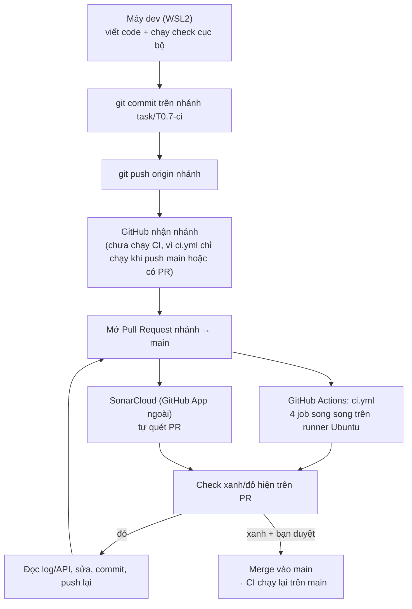
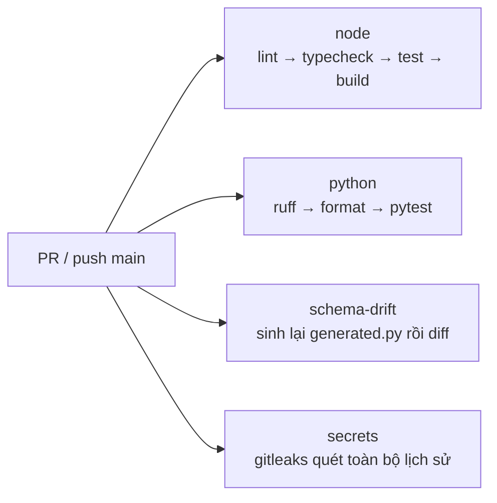

# Quy trình CI/CD của dự án: GitHub Actions, SonarCloud và chi phí

> Mô tả cách CI hoạt động trong dự án này, ai làm bước nào, cách làm việc với GitHub và SonarCloud, và chi phí. Viết sau T0.7 (2026-10-15).
> Nguồn gốc: `.github/workflows/ci.yml`, các script `check:*` trong `package.json`, PR #1 của repo. Khi file này lệch với các nguồn đó, các nguồn đó thắng.

## 0. Hiện tại là CI hay CD?

Mới có **CI** (kiểm tra tự động mỗi khi có code mới). **CD** (tự triển khai) chưa có; nó nằm ở T4.7 và T7.5 trong kế hoạch.

## 1. Toàn cảnh



## 2. Từng bước đã làm ở T0.7, và ai làm

| # | Bước | Lệnh / hành động | Ai làm |
|---|---|---|---|
| 1 | Viết code, chạy cổng cục bộ | `pnpm check:fast`, `pnpm check:full` | Agent |
| 2 | Thử cho cổng fail | Sửa tạm → xem exit khác 0 → revert | Agent |
| 3 | Tạo nhánh | `git switch -c task/T0.7-ci` | Agent, khi bạn yêu cầu |
| 4 | Commit | `git add <file của task>` rồi `git commit` | Agent, khi bạn yêu cầu |
| 5 | Push | `git push -u origin task/T0.7-ci` | Agent, khi bạn yêu cầu |
| 6 | Mở PR #1 | Giao diện GitHub | Bạn |
| 7 | CI tự chạy | GitHub Actions đọc `.github/workflows/ci.yml` | Tự động |
| 8 | SonarCloud tự quét | GitHub App gắn vào repo | Tự động |
| 9 | Đọc kết quả | `gh pr checks 1`, API công khai của SonarCloud | Agent |
| 10 | Sửa và push lại | Commit mới trên cùng nhánh, PR tự cập nhật | Agent, khi bạn yêu cầu |

Agent không tự commit hay push khi bạn chưa yêu cầu (quy tắc trong `CLAUDE.md`).

## 3. GitHub Actions hoạt động thế nào

- **Kích hoạt:** `ci.yml` có `on: push` (nhánh `main`) và `on: pull_request`. Vì thế push lên nhánh phụ chưa chạy gì, phải mở PR.
- **Mỗi job là một máy ảo Ubuntu sạch**, không nhớ gì từ lần trước. Mỗi lần chạy phải cài lại Node, pnpm, uv; phần tăng tốc là cache theo lockfile.
- **4 job chạy song song:**



- **Vì sao tách từng bước:** để dòng đỏ chỉ đúng chặng hỏng (ví dụ chỉ `Typecheck` đỏ), thay vì một lệnh gộp.
- **Cùng lệnh với máy dev:** `check:schema` và `check:secrets` trong `package.json` giống lệnh CI gọi, nên hai nơi không lệch nhau.
- **Bảo mật workflow:** `permissions: contents: read` (quyền tối thiểu), `concurrency` huỷ run cũ cùng nhánh, `astral-sh/setup-uv` ghim theo SHA, `uv` chạy với `--frozen --no-build`.

## 4. SonarCloud hoạt động thế nào

- **Không nằm trong repo hay `ci.yml`.** Đó là GitHub App bạn đã gắn vào repo; nó quét mỗi PR trên máy của Sonar (chế độ quét tự động; đây là suy luận, vì repo không có file cấu hình Sonar).
- **Quy trình:** có PR → Sonar quét phần thay đổi → so với **Quality Gate** → ghi check `SonarCloud Code Analysis` và một comment lên PR.
- **Gate hiện tại** đòi Security Rating A trên code mới. Rating A nghĩa là 0 vấn đề bảo mật; chỉ 1 vấn đề mức MINOR đã xuống B và fail.
- **Đọc kết quả bằng API công khai** (repo public nên không cần token):
  - Danh sách lỗi: `https://sonarcloud.io/api/issues/search?componentKeys=<project>&pullRequest=<N>&resolved=false`
  - Gate OK hay ERROR: `https://sonarcloud.io/api/qualitygates/project_status?projectKey=<project>&pullRequest=<N>`
  - `<project>` của repo này là `conghau113_invoice-intelligence-platform`.
- **Agent không đổi được cấu hình Sonar** (rule, gate, gỡ app). Việc đó làm trên giao diện SonarCloud hoặc ở GitHub → Settings → Integrations.

### Những lỗi Sonar đã bắt ở T0.7 (để lần sau tránh)

| Cảnh báo | Ý nghĩa | Cách xử lý |
|---|---|---|
| S7637 | Action bên thứ ba dùng tag, tag có thể bị di chuyển | Ghim SHA đầy đủ kèm comment phiên bản |
| S8544, S8541 | `uv` có thể tự re-lock hoặc chạy script build của gói nguồn | `uv sync --frozen --no-build`, `uv run --frozen --no-build` |
| S8707, S8705 | Đường dẫn lấy từ `argv` đi vào lệnh `docker -v` | Bỏ script bọc, dùng `docker run` thẳng trong `package.json` |
| S4036 | Gọi `docker` qua biến `PATH` | Không còn khi bỏ script Node |

## 5. Chi phí

| Thành phần | Chi phí hiện tại | Điều kiện / giới hạn |
|---|---|---|
| GitHub Actions | 0đ | Repo **public** thì runner chuẩn miễn phí. Chuyển repo sang private thì tính theo phút, có hạn mức. |
| GitHub (repo, PR) | 0đ | Gói Free |
| SonarCloud | 0đ (đã xác nhận gói Free, 2026-10-15) | Gói Free: không giới hạn dòng code public, tối đa 50k dòng code private (đang dùng 25.468k trong 1 project), tối đa 5 thành viên (đang 1). Chỉ quét nhánh `main` và PR. |
| gitleaks (image Docker) | 0đ | Giấy phép MIT, chạy ngay trên runner |
| Docker Hub (kéo image gitleaks) | 0đ | Kéo ẩn danh có giới hạn số lần theo IP; runner dùng chung IP nên thỉnh thoảng có thể bị chặn. Nếu gặp thì đổi nguồn image. |
| Máy dev (WSL2, Docker Desktop) | 0đ | Của bạn |

Chưa phát sinh khoản nào cần thẻ, đúng ràng buộc 0đ của dự án. Những điều cần để mắt:

- **Không bấm "Start for free" (trial 14 ngày) ở trang Billing của SonarCloud.** Đó là nâng cấp lên gói trả phí (quét nhánh feature, AI CodeFix, tới 1.9M dòng code), có thể yêu cầu thẻ và tự chuyển thành tính phí nếu không huỷ. Chỉ làm khi bạn tự quyết.
- **Không đổi repo sang private** khi chưa tính lại chi phí GitHub Actions và hạn mức 50k dòng code private của SonarCloud (đang dùng 25.468k).
- Billing SonarCloud ghi 25.468k dòng code **private** trong 1 project, dù repo này đang public. Có thể thuộc project khác trong tổ chức hoặc là bản import lúc repo còn private; còn dư 24.5k nên chưa phải vấn đề, nhưng nên xem danh sách Projects để biết chắc.
- Repo chưa có file `LICENSE`. Không ảnh hưởng chi phí SonarCloud với gói Free hiện tại (hạn mức public không giới hạn), nhưng nên cân nhắc cho hồ sơ portfolio; cần đối chiếu `docs/LEGAL.md` và do bạn quyết định.

## 6. CD (để so sánh, chưa làm)

Theo kế hoạch: T4.7 deploy demo lên Oracle Always Free; T7.5 build image multi-arch → GHCR → deploy lên VM, kèm migration, backup, runbook. Tất cả dùng GitHub Actions và registry miễn phí cho repo public. Khi tới đó sẽ có thêm secret (SSH key, token DuckDNS) lưu trong GitHub Secrets.

## 7. Giới hạn cần biết

- Workflow chỉ được chứng minh khi chạy trên GitHub; cục bộ chỉ chạy lại được từng lệnh thành phần.
- Chưa bật branch protection, nên PR đỏ vẫn merge được nếu bấm. Muốn chặn thật, bật yêu cầu các check (`node`, `python`, `schema-drift`, `secrets`, `SonarCloud Code Analysis`) trong Settings → Branches.
- Cache của Turborepo có thể che lỗi ở máy dev ("cached"); CI không có cache đó nên là phép thử thật.
- Phép thử "CI đỏ có chủ đích" của T0.7 (PR có lỗi type, thấy đúng bước `Typecheck` đỏ) cần bạn làm và dán link vào `docs/learning/T0.7-task-notes.md`.

## 8. Lệnh nhanh để tự chạy lại

```bash
pnpm check:fast                  # lint + typecheck + test
pnpm check:full                  # + build + drift + secrets (cần Docker)
pnpm check:schema                # chỉ kiểm schema drift
pnpm check:secrets               # chỉ quét bí mật (cần Docker)
gh pr checks <số PR>             # xem trạng thái check trên PR
gh run view <run-id> --log-failed   # xem log của bước đỏ
```
