# Review toàn hệ thống theo kế hoạch thiết kế

> **Phạm vi:** file này review hệ thống **như đã được lên kế hoạch** (PRD, kiến trúc, ADR, spec các mốc M0 đến M8), không phải những gì đã code. Mục đích: hiểu được toàn bộ hệ thống sẽ trông ra sao, vì sao thiết kế như vậy, và tự kiểm tra xem mình giải thích được chưa.
> **Nguồn gốc của mọi quyết định:** `docs/architecture/ARCHITECTURE.md`, `DATA_MODEL.md`, `AI_PIPELINE.md`, `SECURITY.md`, `API.md`, `docs/architecture/adr/`, `docs/product/{PRD,NFR}.md`, `docs/LEGAL.md`, `docs/plan/`. Khi file này lệch với các nguồn đó, nguồn gốc thắng.
> **Cách đọc:** theo thứ tự các phần 1 đến 12. Cuối mỗi phần có "Tự kiểm tra": trả lời không nhìn tài liệu.

---


## 1. Hệ thống làm gì, cho ai


### 1.1 Mô tả ngắn

Nền tảng SaaS đa tenant giúp doanh nghiệp **tối ưu quy trình nhập liệu hóa đơn**: tải lên hóa đơn điện tử XML, PDF hoặc ảnh chụp, hệ thống tự trích xuất thành dữ liệu có cấu trúc, kiểm tra nghiệp vụ, để kế toán duyệt, rồi cho phép **hỏi đáp bằng ngôn ngữ tự nhiên với trích dẫn nguồn** (phần này dùng RAG, xem mục 4). Giao diện tiếng Việt và tiếng Anh.

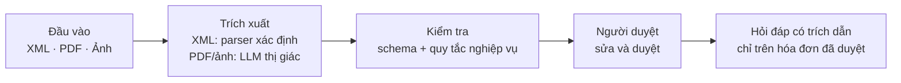


### 1.2 Người dùng và quyền


| Vai trò                                 | Mục tiêu                                                | Quyền chính                                                  |
| --------------------------------------- | ------------------------------------------------------- | ------------------------------------------------------------ |
| `accountant` (Linh, người dùng chính)   | Nhập 100 đến 300 hóa đơn mỗi tháng, ít sai              | Đọc, tạo, duyệt tài liệu, hỏi đáp, xem số liệu               |
| `tenant_admin` (Minh, trưởng tài chính) | Kiểm soát ai được duyệt, xem chi tiêu theo nhà cung cấp | Mọi quyền của accountant + quản lý thành viên, retry job lỗi |
| `viewer` (kiểm toán)                    | Chỉ đọc và hỏi                                          | Đọc, hỏi đáp, xem số liệu                                    |


### 1.3 Ngoài phạm vi

Khai thuế, sổ cái kế toán, thanh toán, xuất hóa đơn, app di động, xử lý dữ liệu thật của khách hàng.

### 1.4 Các màn hình


| Route                        | Mục đích                                                 |
| ---------------------------- | -------------------------------------------------------- |
| `/[locale]/login`            | Đăng nhập qua Keycloak                                   |
| `/[locale]/documents`        | Danh sách, lọc theo trạng thái, tìm kiếm, phân trang     |
| `/[locale]/upload`           | Kéo thả nhiều file, có tiến độ                           |
| `/[locale]/documents/[id]`   | Xem tài liệu cạnh form, cảnh báo, duyệt                  |
| `/[locale]/ask`              | Hỏi đáp có trích dẫn                                     |
| `/[locale]/insights`         | Độ chính xác trích xuất, tỷ lệ sửa, chi phí mỗi tài liệu |
| `/[locale]/settings/members` | Thành viên và vai trò                                    |


### 1.5 Quy tắc nghiệp vụ cốt lõi

1. Tổng các dòng = tạm tính; tạm tính + VAT = tổng (sai số làm tròn ±1 đơn vị nhỏ nhất).
2. Mã số thuế: 10 chữ số, hoặc 10 số + `-` + 3 số cho chi nhánh.
3. Ngày hóa đơn không ở tương lai; tiền tệ nằm trong danh sách cho phép (VND, USD, EUR, JPY).
4. Vi phạm quy tắc chỉ là **cảnh báo** trên field. Hệ thống **không bao giờ tự sửa số**.
5. Chỉ hóa đơn **đã duyệt** mới được đưa vào hỏi đáp.
6. Nội dung file là duy nhất trong mỗi tenant (upload lại trả về bản cũ).
7. Duyệt phải dựa trên phiên bản mới nhất (hai người duyệt cùng lúc thì người sau thất bại).

**Tự kiểm tra**

1. Vì sao cần người duyệt dù đã có AI?
2. Vì sao chỉ hóa đơn đã duyệt mới được tìm kiếm?
3. Vì sao quy tắc nghiệp vụ chỉ cảnh báo mà không tự sửa?

---


## 2. Kiến trúc tổng thể


### 2.1 Bối cảnh hệ thống (C4 mức 1)

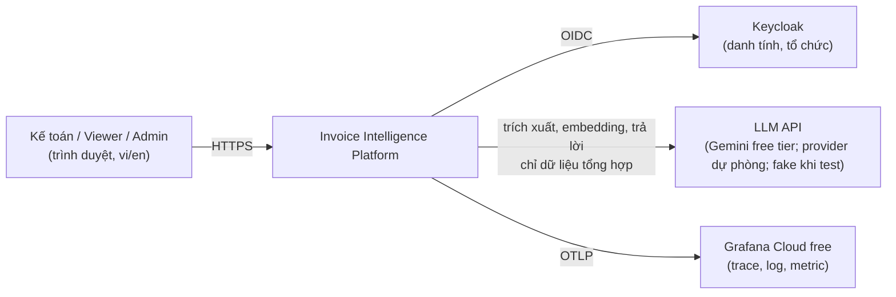


### 2.2 Các container (C4 mức 2)

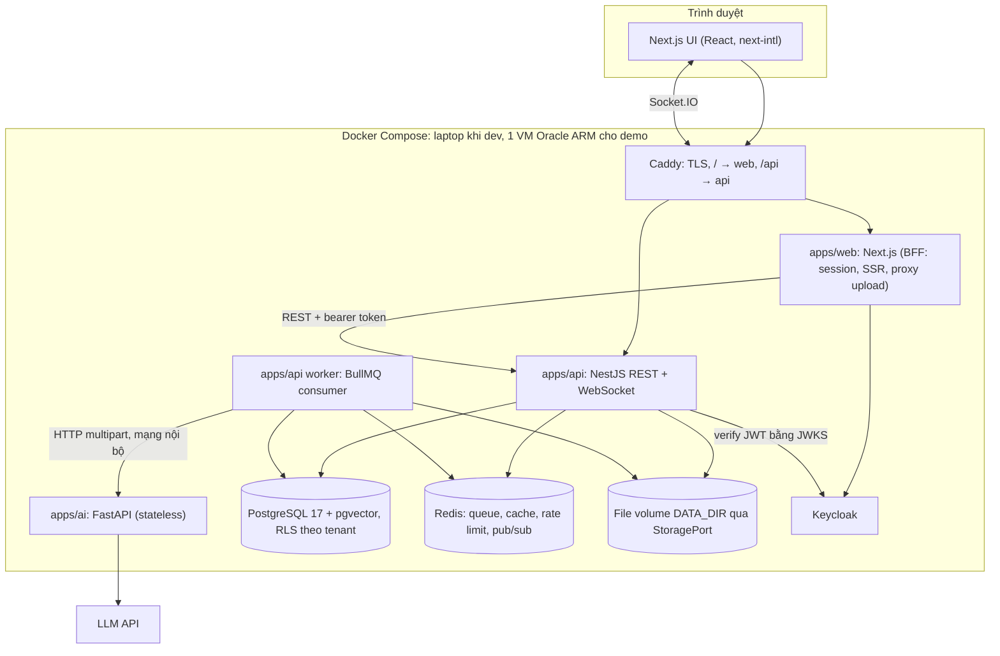


### 2.3 Công nghệ


| Tầng             | Công nghệ                                                                                    | Vai trò                                                        |
| ---------------- | -------------------------------------------------------------------------------------------- | -------------------------------------------------------------- |
| Monorepo         | pnpm workspaces + Turborepo (ADR 0001)                                                       | Một repo, chạy lint/typecheck/test/build theo đồ thị phụ thuộc |
| Frontend         | Next.js (App Router), React, Tailwind, shadcn/ui, next-intl (ADR 0007)                       | UI, i18n, design system                                        |
| Backend          | NestJS (TypeScript strict)                                                                   | API REST, auth, tenant, RBAC, worker hàng đợi, WebSocket       |
| AI               | FastAPI (Python, uv) (ADR 0002)                                                              | Trích xuất, embedding, trả lời; stateless                      |
| Contract         | Zod → JSON Schema → pydantic (ADR 0004)                                                      | Một nguồn sự thật cho cấu trúc dữ liệu giữa TS và Python       |
| Cơ sở dữ liệu    | PostgreSQL 17 + pgvector + Drizzle ORM (ADR 0003, 0011, 0016)                                | Dữ liệu, RLS, tìm kiếm vector và full-text                     |
| Hàng đợi / cache | Redis + BullMQ (ADR 0008, 0012, 0013)                                                        | Queue, cache, rate limit, pub/sub                              |
| Danh tính        | Keycloak, 1 realm, Organizations làm tenant (ADR 0005)                                       | Đăng nhập, tổ chức, role                                       |
| Web auth         | BFF với Auth.js trên server Next.js (ADR 0006)                                               | Token không bao giờ xuống trình duyệt                          |
| Realtime         | Socket.IO + Redis adapter (ADR 0014)                                                         | Thông báo tiến độ                                              |
| LLM              | Gemini free tier sau một interface provider, 1 provider dự phòng (ADR 0009, đang `Proposed`) | Trích xuất PDF/ảnh, embedding, trả lời                         |
| Quan sát         | OpenTelemetry → Grafana Cloud free (ADR 0015)                                                | Một trace đi xuyên 4 dịch vụ                                   |
| Lưu file         | `StoragePort` + adapter filesystem (ADR 0017)                                                | Tách logic khỏi nơi lưu                                        |
| Deploy           | Oracle Cloud Always Free (ARM) + Caddy + DuckDNS + GitHub Actions (ADR 0010)                 | Demo công khai 0đ                                              |


### 2.4 Trách nhiệm từng thành phần và những gì KHÔNG làm


| Thành phần                | Làm                                                                                                                       | Không làm                                           |
| ------------------------- | ------------------------------------------------------------------------------------------------------------------------- | --------------------------------------------------- |
| `apps/web`                | UI, i18n, phiên đăng nhập (token ở server, cookie httpOnly), stream upload tới API                                        | Luật nghiệp vụ bắt buộc; đụng DB hay file trực tiếp |
| `apps/api`                | JWT, tenant, RBAC, kiểm tra upload, tài liệu, duyệt, điều phối hỏi đáp, rate limit, gateway realtime, chế độ demo chỉ đọc | Gọi LLM trực tiếp; việc nặng CPU                    |
| worker (trong `apps/api`) | Xử lý hàng đợi: trích xuất, đánh chỉ mục; retry, circuit breaker                                                          | Phục vụ HTTP                                        |
| `apps/ai`                 | Parse XML, PDF→ảnh, trích xuất bằng LLM theo schema, chunk, embedding, trả lời có trích dẫn                               | Lưu dữ liệu; biết người dùng; mở ra internet        |
| `packages/contracts`      | Schema Zod, quy tắc nghiệp vụ, xuất JSON Schema cho Python                                                                | I/O lúc chạy                                        |
| PostgreSQL                | Nguồn sự thật; RLS; tìm kiếm vector và full-text                                                                          | —                                                   |
| Redis                     | Queue BullMQ, cache, token bucket, pub/sub                                                                                | Làm nguồn sự thật                                   |
| Keycloak                  | Người dùng, tổ chức (tenant), role, token                                                                                 | Quyền chi tiết của ứng dụng                         |
| Caddy                     | TLS, định tuyến theo đường dẫn, security header                                                                           | Logic ứng dụng                                      |


### 2.5 Các mẫu thiết kế dùng có chủ đích


| Mẫu                          | Dùng ở đâu                                                       |
| ---------------------------- | ---------------------------------------------------------------- |
| Ports & Adapters             | `StoragePort`, `LLMProvider`                                     |
| Strategy                     | Đường trích xuất XML so với đường LLM thị giác; các provider LLM |
| State Machine                | Vòng đời tài liệu (`DocumentStateMachine`)                       |
| Repository                   | Truy cập dữ liệu Drizzle theo từng module                        |
| Cache-aside                  | Cache danh sách và dashboard                                     |
| Circuit Breaker              | Khi provider LLM hoặc AI service lỗi liên tục                    |
| Idempotent Consumer          | Job xử lý theo `(document, version)`                             |
| BFF                          | Phiên đăng nhập ở server Next.js                                 |
| Single source of truth       | Contracts Zod → JSON Schema                                      |
| Feature flag theo môi trường | `DEMO_READ_ONLY`                                                 |


### 2.6 Cấu trúc code theo thiết kế

```text
.
├── apps/
│   ├── web/     app/[locale]/... (route mỏng); src/features/<feature>/{components,hooks,api,schemas};
│   │            src/components/common (list/detail/form dùng chung, mọi trang danh sách phải dùng)
│   ├── api/     src/modules/<feature>/{domain,application,infra,http}; src/worker.ts
│   └── ai/      app/{routers,services,providers,prompts,schemas}
├── packages/
│   ├── contracts/  Zod schema, rules, xuất JSON Schema
│   └── logger/     pino config có che PII dùng chung
├── tools/invoice-gen/   Sinh hóa đơn tổng hợp (JSON + XML + PDF), an toàn pháp lý
├── eval/                Bộ dữ liệu, runner, báo cáo (nơi duy nhất gọi LLM thật)
├── infra/               realm Keycloak, caddy, dashboard grafana, compose production, script backup
├── load/                Script k6
└── docs/                Sản phẩm, kiến trúc, ADR, kế hoạch, pháp lý, báo cáo, phỏng vấn
```

**Tự kiểm tra**

1. Vẽ lại sơ đồ container và nêu ranh giới "không làm" của mỗi khối.
2. Vì sao tách `apps/ai` thành service Python riêng? (Việc nặng CPU, timeout và retry riêng, mở rộng độc lập, ít quyền; đánh đổi là thêm một chặng mạng và contract hai ngôn ngữ.)
3. Vì sao `apps/api` không gọi LLM trực tiếp mà để worker gọi?
4. Vì sao file phải đi qua `StoragePort`?

---


## 3. Luồng chính: upload → trích xuất → duyệt

M2 xây luồng này **chỉ với XML** (lát cắt xuyên suốt, chưa có LLM). M3 thêm nhánh LLM cho PDF/ảnh vào đúng luồng đó.

### 3.1 Sequence

```mermaid
sequenceDiagram
  participant U as Trình duyệt
  participant W as web (BFF)
  participant A as api
  participant F as File volume
  participant Q as Redis/BullMQ
  participant K as worker
  participant AI as ai service
  U->>W: upload nhiều phần (≤10 MB)
  W->>A: stream tới POST /documents/upload (bearer, Idempotency-Key)
  A->>F: stream vào tenant/<id>/<uuid>, tính sha256
  A->>A: kiểm magic bytes, chống trùng theo (tenant, sha256)
  A->>Q: enqueue {documentId, tenantId, traceparent}
  A-->>U: 201 status=queued
  K->>Q: lấy job
  K->>F: đọc file
  K->>AI: POST /extract (multipart, service token, traceparent)
  AI->>AI: XML → parser | PDF/ảnh → LLM + JSON Schema
  AI-->>K: invoice JSON + độ tin cậy + usage
  K->>K: validate Zod + quy tắc nghiệp vụ
  K->>A: lưu extraction, status=needs_review
  A-->>U: Socket.IO "document.updated" (M6; trước đó là polling)
```


### 3.2 Vòng đời tài liệu (State Machine)

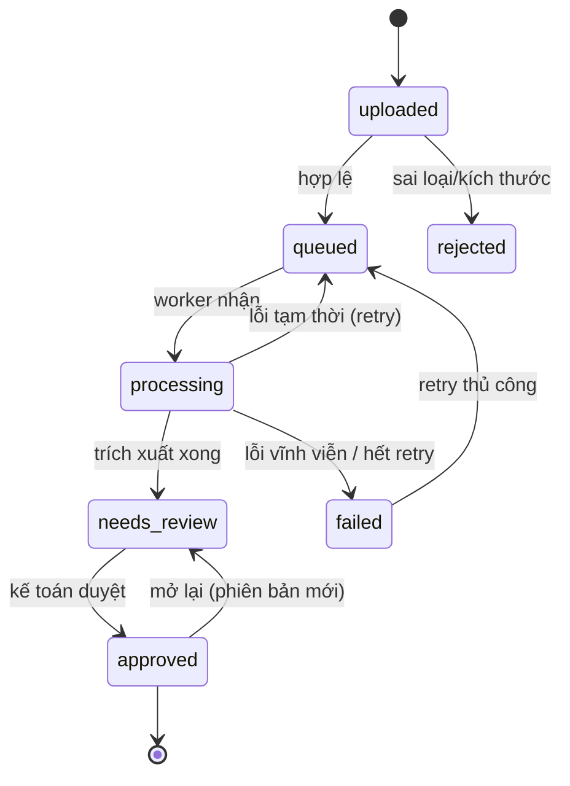


Chỉ `DocumentStateMachine` được đổi `documents.status`. Mỗi lần chuyển trạng thái ghi một dòng audit.

### 3.3 Hai đường trích xuất


| Nguồn                                  | Đường xử lý                                  | Độ chính xác                            | Vì sao                                                                       |
| -------------------------------------- | -------------------------------------------- | --------------------------------------- | ---------------------------------------------------------------------------- |
| XML hóa đơn điện tử Việt Nam           | Parser xác định (`defusedxml`)               | Chính xác tuyệt đối với file đúng chuẩn | Nghị định 123/2020 quy định hóa đơn điện tử dùng XML, nên parse tốt hơn đoán |
| PDF, ảnh, hóa đơn nước ngoài, biên lai | LLM thị giác + đầu ra bị ép theo JSON Schema | Đo ở M4                                 | Không phải mọi chứng từ đều là XML                                           |


Loại nguồn được xác định bằng **magic bytes**, không dựa vào đuôi file.

### 3.4 Chi tiết đường LLM

1. Worker gửi file multipart sang AI qua mạng nội bộ (kèm service token và `traceparent`); AI có giới hạn kích thước và timeout.
2. PDF chuyển thành ảnh từng trang; ảnh được chuẩn hóa (xoay theo EXIF).
3. Gọi provider (Strategy): hướng dẫn hệ thống + JSON Schema làm schema phản hồi. **Nội dung tài liệu chỉ đi vào dưới dạng phần dữ liệu (ảnh), không bao giờ ghép vào câu lệnh hướng dẫn.**
4. Validate bằng pydantic. Lỗi thì thử lại tối đa 2 lần kèm thông báo lỗi; vẫn lỗi thì trả mã `EXTRACTION_SCHEMA_INVALID`.
5. Trả về `invoice`, `fieldMeta` (độ tin cậy và bằng chứng từng field) và `usage` (model, token, độ trễ, chi phí). Chi phí tính từ bảng giá có phiên bản trong cấu hình.
6. Phiên bản prompt lưu cùng mỗi lần trích xuất để so sánh kết quả eval.


### 3.5 Xử lý lỗi theo thiết kế


| Sự cố                     | Hành vi mong đợi                                                                       |
| ------------------------- | -------------------------------------------------------------------------------------- |
| Provider trả 429          | Tôn trọng `Retry-After`, backoff lũy thừa có jitter, limiter của hàng đợi giữ dưới RPM |
| LLM trả JSON sai          | Thử lại tối đa 2 lần kèm lỗi, rồi `failed` có mã lỗi                                   |
| AI service sập            | Job retry có backoff; circuit breaker tạm dừng hàng đợi; không mất dữ liệu             |
| Redis sập                 | API trả 503 cho upload/queue; đọc từ Postgres vẫn chạy; job tiếp tục sau khi phục hồi  |
| Worker bị kill giữa chừng | Job thành stalled và được thử lại; xử lý idempotent theo `(document, version)`         |
| Upload trùng              | Cùng `(tenant, sha256)` trả về tài liệu cũ                                             |
| Hai người duyệt cùng lúc  | Khóa lạc quan (`If-Match`), người sau nhận `409`                                       |
| Hết quota free tier       | Job chờ limiter rồi fail với mã rõ ràng; đổi provider bằng cấu hình                    |


**Tự kiểm tra**

1. Mô tả đường đi của một file XML từ lúc upload đến `needs_review`, và 3 điểm có thể lỗi.
2. Vì sao XML không dùng LLM?
3. Hai worker cùng nhận một job thì điều gì ngăn việc ghi trùng?
4. Vì sao phải kiểm magic bytes mà không tin đuôi file?

---


## 4. Luồng hỏi đáp có trích dẫn (RAG)


### 4.0 RAG là gì, và dự án dùng ở đâu

**RAG (Retrieval-Augmented Generation)** nghĩa là: trước khi LLM trả lời, hệ thống **tìm các đoạn tài liệu liên quan** trong dữ liệu của chính mình, đưa chúng cho LLM làm căn cứ, và bắt LLM trích dẫn nguồn. Mục đích là câu trả lời bám vào dữ liệu thật (giảm bịa) và kiểm chứng được.

Dự án **chỉ dùng RAG ở tính năng hỏi đáp (mốc M5)**, không dùng ở phần trích xuất:

| Phần của hệ thống | Có dùng RAG không | Cách làm |
|---|---|---|
| Trích xuất XML (M2) | Không | Parser xác định, không có LLM |
| Trích xuất PDF/ảnh (M3) | Không | LLM thị giác đọc trực tiếp một tài liệu, ép theo JSON Schema; không truy hồi gì cả |
| Hỏi đáp loại **tra cứu** ("hóa đơn nào mua laptop?") | **Có** | Truy hồi hybrid (vector + full-text) rồi LLM trả lời có trích dẫn |
| Hỏi đáp loại **tổng hợp số liệu** ("quý 3 đã trả ACME bao nhiêu?") | Không | LLM chỉ sinh bộ lọc có cấu trúc, API chạy SQL có tham số, LLM diễn đạt kết quả. Đây là text-to-filter, không phải RAG |

API quyết định câu hỏi đi đường nào ở bước phân loại (xem sơ đồ 4.2). Công nghệ liên quan: pgvector + HNSW (ADR 0011), `gemini-embedding-001` 768 chiều, Postgres full-text, RRF.

**Trạng thái:** mới là thiết kế, chưa có code. Bản demo công khai không gọi LLM nên chỉ trả đáp án tính sẵn cho vài câu hỏi mẫu (ADR 0018).

### 4.1 Lập chỉ mục

- **Chỉ lập chỉ mục hóa đơn đã duyệt** (dữ liệu đã được người xác minh).
- Chunk: một chunk tiêu đề cho mỗi hóa đơn (các bên, ngày, tổng) + các chunk gộp dòng hàng. Metadata: `{tenant_id, invoice_id, page, field_paths}`.
- Embedding `gemini-embedding-001` cắt về 768 chiều, lưu trong `vector(768)` với chỉ mục HNSW cosine; kèm `tsvector` với GIN cho full-text.


### 4.2 Trả lời

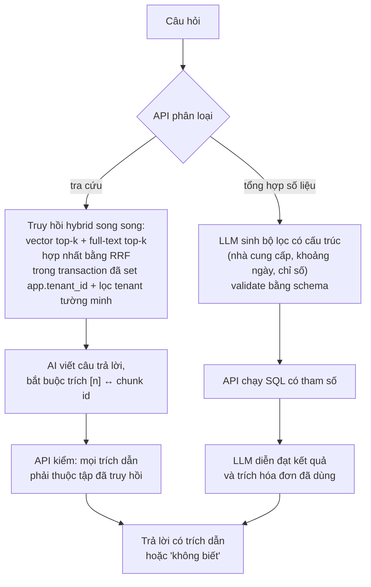


Điểm mấu chốt: **LLM không bao giờ viết SQL và không tự cộng tổng**. Nếu không đủ bằng chứng thì trả lời "không biết" bằng ngôn ngữ của người hỏi.

### 4.3 Đo chất lượng RAG

30 câu hỏi vàng (vi/en) với đáp án và nguồn mong đợi. Số đo: hit@5, độ chính xác trích dẫn, độ đúng của đáp án số, độ bám nguồn (LLM-as-judge, đối chiếu tay 10 mẫu).

**Tự kiểm tra**

1. Vì sao cần truy hồi hybrid thay vì chỉ vector?
2. Vì sao câu hỏi tổng hợp số liệu không giao cho LLM tự tính?
3. API kiểm trích dẫn để chặn loại lỗi nào?
4. Phần nào của hệ thống dùng RAG và phần nào không? Vì sao câu hỏi tổng hợp số liệu không đi đường RAG?

---


## 5. Đa tenant, danh tính và phân quyền (Keycloak + RLS + RBAC)


### 5.1 Ai làm gì (đây là điểm dễ nói nhầm)


| Mối quan tâm                                                    | Do ai đảm nhiệm                                                  |
| --------------------------------------------------------------- | ---------------------------------------------------------------- |
| Danh tính, đăng nhập, token                                     | **Keycloak** (1 realm `invoice`, mỗi tenant là một Organization) |
| Vai trò của người dùng (`tenant_admin`, `accountant`, `viewer`) | Gán trong **Keycloak**, nằm trong token                          |
| Kiểm tra quyền khi gọi API                                      | **NestJS**: `@RequirePermission`, mặc định từ chối               |
| **Cách ly dữ liệu giữa các tenant**                             | **PostgreSQL Row-Level Security**, không phải Keycloak           |


Keycloak nói "bạn là ai và thuộc tổ chức nào". Postgres RLS mới là thứ đảm bảo dù code quên lọc thì dữ liệu cũng không lộ.

### 5.2 Chuỗi cách ly tenant (phòng thủ nhiều lớp)

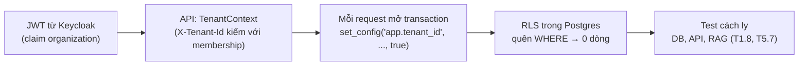


Cấu hình RLS theo thiết kế (mọi bảng nghiệp vụ có `tenant_id`):

```sql
ALTER TABLE documents ENABLE ROW LEVEL SECURITY;
ALTER TABLE documents FORCE ROW LEVEL SECURITY;
CREATE POLICY tenant_isolation ON documents
  USING      (tenant_id = current_setting('app.tenant_id', true)::uuid)
  WITH CHECK (tenant_id = current_setting('app.tenant_id', true)::uuid);
```

- Ứng dụng kết nối bằng role **không phải chủ bảng và không có** `BYPASSRLS`; migration chạy bằng role chủ. (Superuser và chủ bảng bỏ qua RLS, đây là lý do phải tách role.)
- `set_config(..., true)` chỉ có hiệu lực trong transaction, an toàn khi dùng connection pool.
- RAG vừa chạy trong transaction có `app.tenant_id` **vừa** lọc tenant tường minh (hai lớp).


### 5.3 Ma trận quyền (RBAC)


| Quyền                              | tenant_admin | accountant | viewer |
| ---------------------------------- | ------------ | ---------- | ------ |
| `document:read`                    | ✓            | ✓          | ✓      |
| `document:create`                  | ✓            | ✓          |        |
| `document:approve`                 | ✓            | ✓          |        |
| `document:manage` (retry, job lỗi) | ✓            |            |        |
| `qa:ask`                           | ✓            | ✓          | ✓      |
| `insights:read`                    | ✓            | ✓          | ✓      |
| `tenant:manage`                    | ✓            |            |        |


- Quyền là chuỗi (`document:approve`), ánh xạ từ role ở **một file duy nhất**; endpoint khai báo quyền cần có.
- UI ẩn nút người dùng không có quyền (để dễ dùng); **API mới là nơi thực thi** (để an toàn).
- Tài khoản demo: cờ chỉ-đọc được ép ở guard của API (mọi method không phải GET bị từ chối), không giả bằng role.


### 5.4 Đăng nhập trên web (BFF)

- Auth.js chạy trên server Next.js, luồng Authorization Code + PKCE.
- Token nằm trong cookie mã hóa httpOnly, `Secure`, `SameSite=Lax`; trình duyệt không bao giờ thấy access token.
- API xác thực chữ ký JWT qua JWKS (có cache, chịu được xoay khóa), kiểm `iss`, `aud`, `exp`, `nbf`. Không có token thì 401.
- Tenant do `organization` claim quyết định; nếu thuộc nhiều tenant, header `X-Tenant-Id` chọn một và **luôn được kiểm với membership**, không bao giờ tin riêng nó.

**Tự kiểm tra**

1. Vì sao cách ly tenant dựa vào Postgres RLS chứ không phải Keycloak?
2. Quên `WHERE tenant_id` thì điều gì xảy ra? Khi nào RLS vẫn không bảo vệ được? (Kết nối bằng chủ bảng hoặc `BYPASSRLS`.)
3. Vì sao dùng BFF thay vì lưu token ở trình duyệt?
4. Vì sao UI ẩn nút nhưng API vẫn phải kiểm quyền?

---


## 6. Dữ liệu


### 6.1 ERD

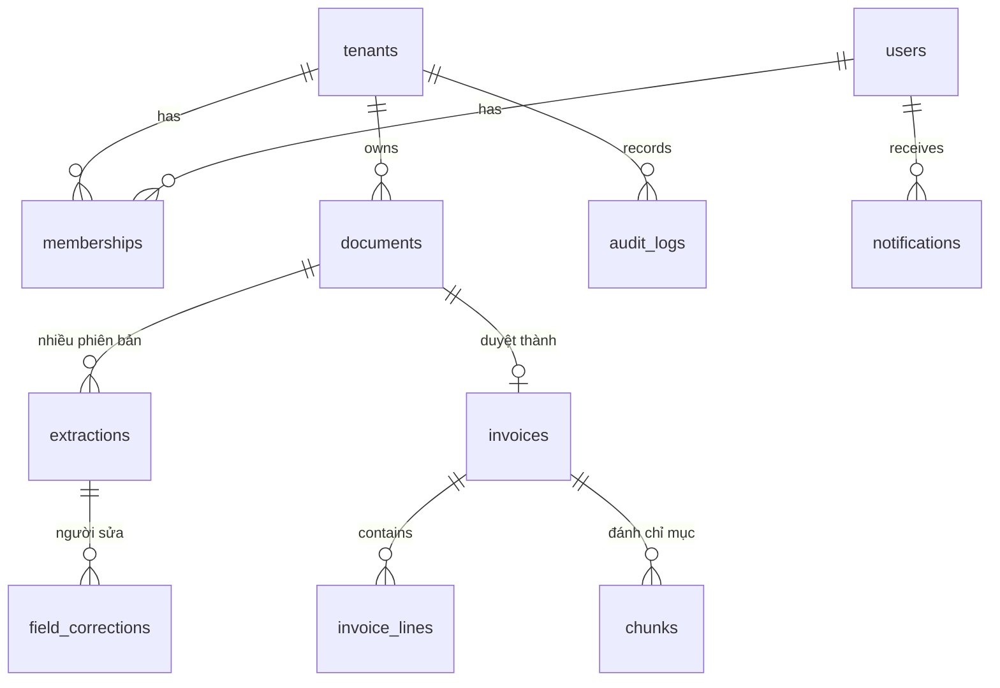


### 6.2 Ý nghĩa từng bảng


| Bảng                              | Điểm cần nhớ                                                                                                                                                      |
| --------------------------------- | ----------------------------------------------------------------------------------------------------------------------------------------------------------------- |
| `tenants`, `users`, `memberships` | Tenant ↔ Organization của Keycloak (1:1). User tạo lười khi đăng nhập lần đầu. Quyết định phân quyền dùng **token**, bảng `memberships` chỉ để liệt kê thành viên |
| `documents`                       | Trạng thái theo state machine; `UNIQUE (tenant_id, content_hash)` cho idempotency; `version` tăng khi mở lại sau duyệt                                            |
| `extractions`                     | **Chỉ thêm, không sửa**: mỗi lần chạy là một dòng (model, phiên bản prompt, token, chi phí, độ trễ) → báo cáo chi phí và so sánh A/B có sẵn                       |
| `field_corrections`               | Một dòng cho mỗi field người duyệt đã sửa → nuôi chỉ số "tỷ lệ sửa"                                                                                               |
| `invoices`, `invoice_lines`       | Chỉ ghi khi duyệt; `row_version` cho khóa lạc quan                                                                                                                |
| `chunks`                          | `vector(768)` + HNSW, `tsvector` + GIN, `refs` để trích dẫn                                                                                                       |
| `audit_logs`                      | Chỉ thêm; **chỉ lưu id và tên hành động, không lưu nội dung trích xuất**                                                                                          |


### 6.3 Quy ước dữ liệu

- Tiền lưu `bigint` theo đơn vị nhỏ nhất của loại tiền (VND không có đơn vị nhỏ hơn; USD tính bằng cent).
- Thời gian là `timestamptz` (UTC), ngày theo ISO 8601.
- Mọi bảng nghiệp vụ có `tenant_id` và RLS.

**Tự kiểm tra**

1. Vì sao `extractions` chỉ thêm, không sửa?
2. Vì sao tiền lưu số nguyên?
3. Vì sao `audit_logs` không lưu giá trị đã trích xuất?

---


## 7. Hợp đồng dữ liệu giữa TypeScript và Python

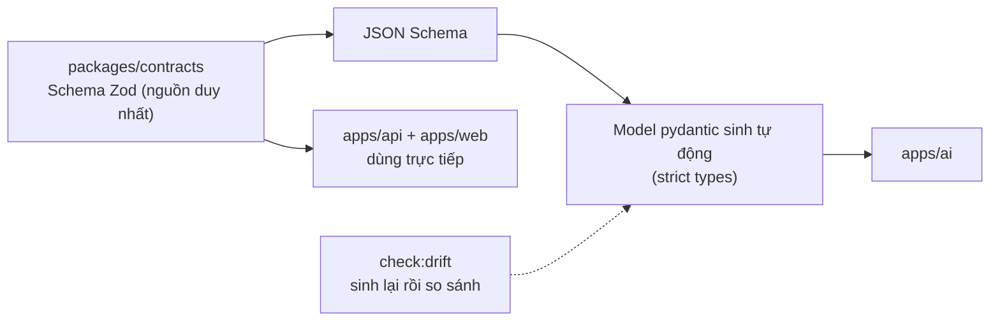


- Cấu trúc hóa đơn: `seller`, `buyer` (tên, mã số thuế, địa chỉ), `invoiceNo`, `series`, `issueDate`, `currency`, `lines[]`, `subtotal`, `vatBreakdown[]`, `total`, và `fieldMeta` (độ tin cậy + bằng chứng từng field).
- Quy tắc nghiệp vụ là mã TypeScript dùng chung, chạy ở worker.
- Mã số thuế chỉ kiểm **định dạng**, cố ý **không** kiểm chữ số kiểm tra, vì dữ liệu tổng hợp dùng chữ số kiểm tra sai để không trùng doanh nghiệp thật.
- Test hợp đồng: cùng một fixture chạy ở Jest và pytest để hai phía không lệch.

**Tự kiểm tra**

1. Vì sao Zod là nguồn duy nhất và Python được sinh ra?
2. `check:drift` phát hiện loại lỗi nào?
3. Vì sao có thể có chênh lệch nhỏ giữa Zod và pydantic, và test hợp đồng giảm rủi ro đó thế nào?

---


## 8. API

Cơ sở: REST, JSON, `/api/v1`, OpenAPI sinh từ decorator NestJS.


| Quy ước     | Quy tắc                                                                                                      |
| ----------- | ------------------------------------------------------------------------------------------------------------ |
| Xác thực    | `Authorization: Bearer`, từ chối mặc định, `@Public()` chỉ cho health                                        |
| Lỗi         | RFC 9457 Problem Details: `{type, title, status, detail, instance, code, traceId}`                           |
| Phân trang  | Theo cursor: `?limit=20&cursor=...` → `{items, nextCursor}`                                                  |
| Idempotency | Header `Idempotency-Key` cho POST tạo mới; phát lại trả bản phản hồi cũ trong 24 giờ                         |
| Đồng thời   | `If-Match: <rowVersion>` khi duyệt/sửa; cũ thì `409`                                                         |
| Rate limit  | `429` kèm `Retry-After` và `RateLimit-*`                                                                     |
| Truy vết    | `traceparent` (W3C) được nhận và truyền đi                                                                   |
| Demo        | `DEMO_READ_ONLY=true` → mọi request không phải GET trả `403 DEMO_READ_ONLY`; hỏi đáp chỉ trả đáp án tính sẵn |


Nhóm endpoint chính:

- **Health**: `/health` (liveness, công khai), `/health/ready` (readiness: DB, Redis, JWKS Keycloak).
- **Documents**: upload, danh sách có lọc, chi tiết, tải file (qua API sau khi kiểm quyền), retry, approve, reopen.
- **Q&A**: `POST /qa/ask` (SSE: token, citations, done), `GET /qa/history`.
- **Insights, Notifications, Admin** (job lỗi, retry job).
- **Realtime** (Socket.IO, namespace `/realtime`): sự kiện `document.updated`, `notification.created`; client coi sự kiện chỉ là gợi ý và tải lại bằng REST vì sự kiện có thể bị bỏ lỡ.
- **API nội bộ của AI** (không công khai): `/extract`, `/embed`, `/answer`, `/plan-query`.

**Tự kiểm tra**

1. Idempotency-Key và hash nội dung giải quyết hai vấn đề khác nhau thế nào?
2. Vì sao phân trang theo cursor?
3. Vì sao client xem sự kiện realtime là gợi ý?

---


## 9. Các mối quan tâm xuyên suốt


### 9.1 Redis không chỉ để cache

Redis có bốn vai trò, trong đó **hàng đợi là quan trọng nhất**:

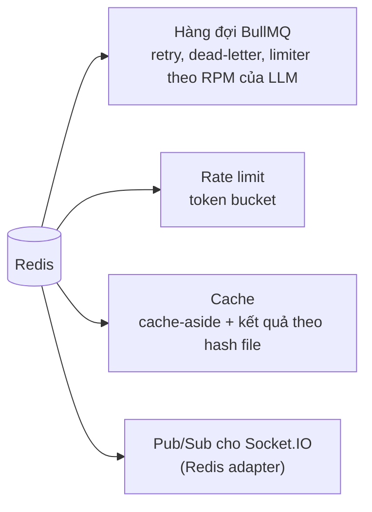


| Vai trò                      | Thiết kế                                                                                         |
| ---------------------------- | ------------------------------------------------------------------------------------------------ |
| Cache-aside                  | Đọc danh sách/dashboard: kiểm cache, trượt thì đọc DB rồi ghi cache; vô hiệu hóa khi dữ liệu đổi |
| Cache kết quả theo hash file | Cùng nội dung file thì không gọi LLM lần nữa                                                     |
| Rate limit                   | Token bucket trong Redis; vượt thì `429` + `Retry-After`                                         |
| Hàng đợi                     | Producer ở API, consumer ở worker; retry có backoff, dead-letter, idempotent                     |
| Realtime                     | Redis adapter để nhiều instance Socket.IO dùng chung                                             |


Redis **không** là nguồn sự thật: Redis sập thì đọc từ Postgres vẫn chạy.

### 9.2 Đa ngôn ngữ (i18n)

- `next-intl`, route có tiền tố ngôn ngữ (`/vi/...`, `/en/...`). Ngôn ngữ mặc định lấy từ cookie → `Accept-Language` → tiếng Việt.
- Mọi chuỗi hiển thị qua i18n, khóa ở **cả** `vi.json` và `en.json`; có script CI kiểm tra khóa khớp nhau.
- Số, ngày, tiền định dạng theo locale bằng `Intl`. Câu trả lời hỏi đáp theo ngôn ngữ của câu hỏi.


### 9.3 Design system

- Tailwind + shadcn/ui; một **design baseline** (màu, chữ, khoảng cách, các trạng thái, accessibility) chốt trước khi dựng app shell.
- Khối dùng chung (danh sách, chi tiết, form) nằm ở `src/components/common`; mọi trang danh sách phải dùng lại.


### 9.4 Quan sát hệ thống

- OpenTelemetry: **một trace đi từ trình duyệt qua web, api, hàng đợi, worker tới ai** (propagate `traceparent` qua job).
- Log JSON có `trace_id`, `span_id`, `tenant_id`; che email, số điện thoại, mã số thuế, tên người/công ty.
- Span chứa tên model và số token, **không bao giờ chứa prompt hay nội dung tài liệu**.
- Metric, dashboard, hai cảnh báo (M7).

**Tự kiểm tra**

1. Kể bốn vai trò của Redis trong hệ thống. Vai trò nào gây mất dữ liệu nếu Redis mất, và thiết kế giảm thiểu thế nào?
2. Cache-aside khác write-through ở điểm nào?
3. Vì sao log phải che PII dù dữ liệu là tổng hợp?

---


## 10. Bảo mật và pháp lý


### 10.1 Mô hình mối đe dọa


| Tài sản        | Mối đe dọa                                                                             | Kiểm soát chính                                                                                         |
| -------------- | -------------------------------------------------------------------------------------- | ------------------------------------------------------------------------------------------------------- |
| Dữ liệu tenant | Đọc/ghi chéo tenant                                                                    | RLS + lọc tường minh + test cách ly                                                                     |
| Tài khoản      | Đánh cắp token, session fixation                                                       | PKCE, cookie httpOnly (BFF), token ngắn hạn, xoay refresh                                               |
| Luồng upload   | File độc, XXE, path traversal, file quá lớn                                            | Stream qua API có giới hạn, magic bytes, khóa lưu do server sinh, `defusedxml`, timeout                 |
| Tính năng LLM  | Prompt injection (trực tiếp và gián tiếp qua tài liệu đã lưu), rò dữ liệu, tốn chi phí | Tách chỉ thị/dữ liệu, đầu ra ép schema, kiểm trích dẫn, rules engine, rate limit, hạn ngạch theo tenant |
| Bí mật         | Lộ qua repo/log                                                                        | `.env` không commit, hook chặn agent đụng `.env`, gitleaks trong CI                                     |
| Demo công khai | Lạm dụng, chi phí, nhận dữ liệu thật                                                   | Chỉ-đọc, không upload, không gọi LLM                                                                    |
| Máy chủ demo   | Bị xâm nhập                                                                            | Chỉ SSH key, chỉ mở 80/443, container không chạy root, tự cập nhật bảo mật                              |
| Log/telemetry  | Rò PII                                                                                 | Log cấu trúc có che, không có nội dung tài liệu                                                         |


### 10.2 Coi LLM là thành phần không đáng tin

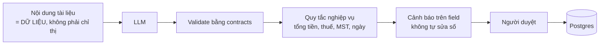


Ba lớp chặn: **schema** bắt sai cấu trúc, **quy tắc** bắt sai nghiệp vụ, **người duyệt** bắt phần còn lại. Đầu ra LLM không bao giờ được thực thi, và LLM không viết SQL.

### 10.3 Pháp lý và chi phí

- **Chỉ dữ liệu tổng hợp** ở mọi nơi: mã số thuế chữ số kiểm tra sai, tên có hậu tố `SAMPLE`, watermark `SAMPLE – SYNTHETIC DATA`.
- Gemini free tier (Unpaid Services): Google có thể dùng nội dung gửi lên để cải thiện sản phẩm và người có thể đọc, nên **chỉ gửi dữ liệu tổng hợp**; ứng dụng phục vụ người dùng ở EEA/Thụy Sĩ/Anh phải dùng bản trả phí → bản demo công khai không gọi LLM (ADR 0018).
- Không dùng proxy định tuyến qua tài khoản đăng nhập cá nhân của dịch vụ AI (vi phạm điều khoản).
- **Chi phí 0đ:** local, Oracle Always Free, DuckDNS, GitHub Actions (repo public). Mọi mục tốn tiền chỉ là tùy chọn và cần chủ dự án duyệt.
- Giấy phép thư viện phải nằm trong allow-list (MIT, Apache-2.0, BSD, ISC, MPL-2.0, PostgreSQL, Python-2.0). Redis 8 dùng theo AGPLv3, không sửa, chạy như container riêng.

**Tự kiểm tra**

1. Prompt injection gián tiếp là gì, và hệ thống chặn bằng những lớp nào?
2. Vì sao URL file không bao giờ công khai (tải qua API sau khi kiểm quyền)?
3. Vì sao demo công khai không gọi LLM?

---


## 11. Triển khai, chất lượng và lộ trình


### 11.1 Môi trường


| Môi trường             | Cách chạy                                                                                                                                     | Chi phí |
| ---------------------- | --------------------------------------------------------------------------------------------------------------------------------------------- | ------- |
| Local (mặc định)       | Windows + WSL2 Ubuntu + Docker Desktop: `docker compose` cho Postgres, Redis, Keycloak; ứng dụng chạy bằng `pnpm dev`; LLM giả                | 0       |
| Demo công khai (từ M4) | 1 VM Oracle Always Free (ARM, 2 OCPU, 12 GB), Docker Compose, Caddy (HTTPS tự động), DuckDNS, image multi-arch từ GHCR, `DEMO_READ_ONLY=true` | 0       |
| Dự phòng               | Nếu VM bị thu hồi: dựng lại từ runbook, hoặc dùng video demo                                                                                  | 0       |
| CI                     | GitHub Actions trên repo public                                                                                                               | 0       |


Backup mã hóa hằng ngày lưu **ngoài** Oracle; mục tiêu RPO 24 giờ, RTO dưới 1 giờ.

### 11.2 Chiến lược test và cổng chất lượng

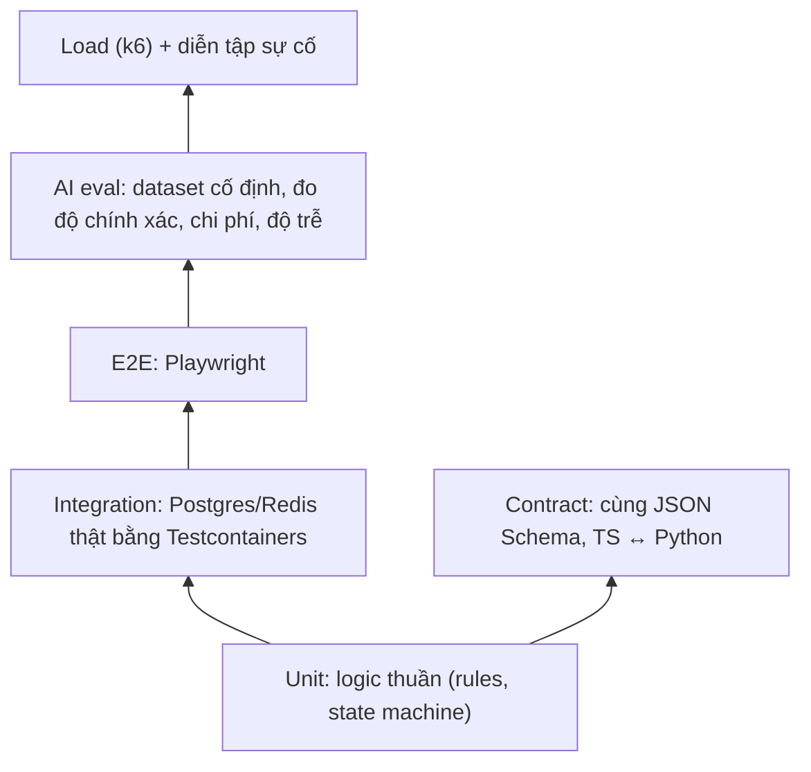


- Test và CI **luôn dùng LLM giả**; chỉ `eval/` gọi model thật.
- Test phải **chạy hành vi**, không viết test kiểu đọc mã nguồn tìm chuỗi.
- Cổng `check:fast` (lint, typecheck, unit) chạy liên tục; `check:full` (thêm integration, e2e, drift schema, i18n, ADR, link, gitleaks, licence) chạy trước khi commit và trong CI.
- Mỗi cổng mới phải có một lần thử cho **fail**, vì cổng không thể fail là cổng vô dụng.


### 11.3 Mục tiêu phi chức năng (NFR)


| Thuộc tính              | Mục tiêu v1                                                                             |
| ----------------------- | --------------------------------------------------------------------------------------- |
| Cách ly tenant          | 0 lần đọc/ghi chéo trong test (DB, API, RAG)                                            |
| Độ trễ đọc API          | p95 < 300 ms ở 20 người dùng đồng thời                                                  |
| Xác nhận upload         | p95 < 500 ms (không tính xử lý)                                                         |
| Độ trễ trích xuất       | p95 < 30 giây mỗi tài liệu một trang                                                    |
| Độ chính xác trích xuất | Ngưỡng đặt theo baseline đo đầu tiên, ghi vào ADR                                       |
| Chất lượng RAG          | Báo cáo hit@5 và độ chính xác trích dẫn; mọi câu trả lời hoặc có trích dẫn hoặc từ chối |
| Chịu lỗi                | Không mất hay trùng job khi AI, worker hoặc Redis khởi động lại                         |
| Quan sát                | Một trace xuyên web → api → worker → ai                                                 |
| Hiệu năng web           | LCP ≤ 2.5 s, INP ≤ 200 ms, CLS ≤ 0.1                                                    |
| i18n                    | Khóa vi/en khớp 100%, không chuỗi cứng                                                  |
| Chi phí hạ tầng         | 0                                                                                       |


Quy tắc trung thực: mục tiêu chưa đo được là **giả thuyết**, không phải khẳng định.

### 11.4 Lộ trình 8 mốc

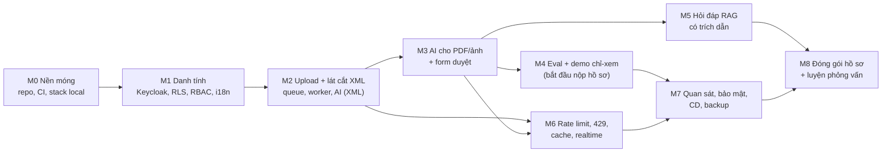


| Mốc | Kết quả demo được                                                                     |
| --- | ------------------------------------------------------------------------------------- |
| M0  | Môi trường WSL2, monorepo, CI, stack local                                            |
| M1  | Hai user ở hai tenant chỉ thấy dữ liệu của mình; đổi vi/en; viewer không thấy nút ghi |
| M2  | Upload một file XML đi trọn luồng đến `needs_review`; upload trùng không tạo job mới  |
| M3  | Upload PDF, form tự điền, field độ tin cậy thấp tô vàng, sửa và duyệt                 |
| M4  | Số đo độ chính xác/chi phí, demo chỉ-xem công khai                                    |
| M5  | Hỏi đáp có trích dẫn, kiểm tra rò dữ liệu chéo tenant                                 |
| M6  | Rate limit, xử lý 429, cache, realtime, diễn tập sự cố                                |
| M7  | Trace xuyên 4 dịch vụ, rà soát bảo mật, CD tự động, backup                            |
| M8  | README, kiến trúc hoàn chỉnh, video demo, ngân hàng câu hỏi phỏng vấn                 |


Quy tắc cắt khi trễ: cắt chiều rộng (ít kịch bản hơn), **không** cắt cách ly tenant, bảo mật, tính đúng của dữ liệu và test luồng chính.

---


## 12. Tổng kết và tự đánh giá


### 12.1 Điểm mạnh của thiết kế

- **Coi AI là thành phần không đáng tin:** ba lớp chặn (schema, quy tắc, người duyệt), đo bằng dữ liệu cố định.
- **Cách ly tenant chịu được lỗi của dev:** RLS ở tầng DB nằm dưới bộ lọc ứng dụng, có test chứng minh.
- **Bất đồng bộ chịu lỗi:** hàng đợi, retry, backoff, idempotent, circuit breaker, diễn tập sự cố.
- **Một nguồn sự thật cho dữ liệu:** Zod → JSON Schema → Python, kiểm drift.
- **Ràng buộc chi phí và pháp lý ngay từ đầu:** 0đ, dữ liệu tổng hợp, demo chỉ đọc.


### 12.2 Các đánh đổi và rủi ro của chính thiết kế


| #   | Rủi ro / đánh đổi                                                | Cách thiết kế xử lý                                                               |
| --- | ---------------------------------------------------------------- | --------------------------------------------------------------------------------- |
| 1   | Role DB của app bỏ qua RLS nếu là chủ bảng/superuser             | Role riêng không phải chủ bảng, không `BYPASSRLS`; test cách ly bằng DB thật      |
| 2   | Tách service AI thêm một chặng mạng và contract hai ngôn ngữ     | Contract một nguồn + test chéo + kiểm drift                                       |
| 3   | Lệch ngữ nghĩa Zod và pydantic ở biên (ngày, pattern)            | `strict-types`, fixture dùng chung; mở rộng fixture khi chốt schema               |
| 4   | Free tier LLM có giới hạn RPM/TPM/RPD và thay đổi theo thời gian | Cấu hình thay vì hằng số, limiter, backoff, provider dự phòng, LLM giả trong test |
| 5   | ADR 0009 (provider LLM) chưa chốt                                | Sau interface provider; xác nhận bằng số đo M4                                    |
| 6   | Synthetic sạch hơn scan thật nên eval lạc quan                   | Báo cáo nêu rõ; tỷ lệ sửa từ người dùng là chỉ số online bổ sung                  |
| 7   | Oracle Always Free có thể thu hồi khi nhàn rỗi                   | Giữ stack chạy, runbook dựng lại, backup ngoài Oracle, phương án video            |
| 8   | Parser XML chỉ hỗ trợ cấu trúc do bộ sinh tạo                    | Nêu rõ giới hạn, tài liệu cách thêm mapping nhà cung cấp mới                      |
| 9   | Redis 8 dùng giấy phép AGPLv3                                    | Dùng không sửa, container riêng; ghi vào LEGAL.md                                 |


### 12.3 Bản giải thích ngắn

> "Đây là SaaS đa tenant giúp doanh nghiệp tối ưu việc nhập liệu hóa đơn. Hóa đơn điện tử XML được parse trực tiếp; PDF và ảnh chụp được LLM thị giác trích xuất theo JSON Schema. Kết quả đi qua kiểm tra nghiệp vụ rồi để kế toán duyệt, sau đó có thể hỏi đáp và nhận câu trả lời kèm trích dẫn hóa đơn nguồn. Frontend Next.js với i18n vi/en và design system shadcn/ui; backend NestJS; phần AI là service FastAPI riêng. Keycloak lo danh tính và role (RBAC), NestJS thực thi quyền, còn **dữ liệu được cách ly giữa các tenant bằng Row-Level Security của Postgres**. Redis dùng cho hàng đợi, cache, rate limit và realtime."


### 12.4 Tự kiểm tra cuối (không mở tài liệu)

1. Vẽ lại sơ đồ container và nêu ranh giới "không làm" của từng khối.
2. Mô tả đường đi của một file XML từ lúc upload đến `needs_review`, và 3 điểm có thể lỗi.
3. Phân biệt trách nhiệm của Keycloak, NestJS và Postgres RLS trong bài toán đa tenant và phân quyền.
4. Giải thích vì sao quên `WHERE tenant_id` không làm lộ dữ liệu, và khi nào RLS vẫn không bảo vệ được.
5. Nêu ba lớp chặn LLM làm sai và lớp nào bắt được lỗi gì.
6. Vì sao hỏi đáp tổng hợp số liệu không để LLM viết SQL hay tự tính?
7. Kể bốn vai trò của Redis và hệ quả khi Redis sập.
8. Chọn ba quyết định kiến trúc bạn sẽ bảo vệ và một quyết định bạn muốn xem lại, kèm lý do và ADR liên quan.

---


## Phụ lục: quy trình làm việc với agent (theo kế hoạch)

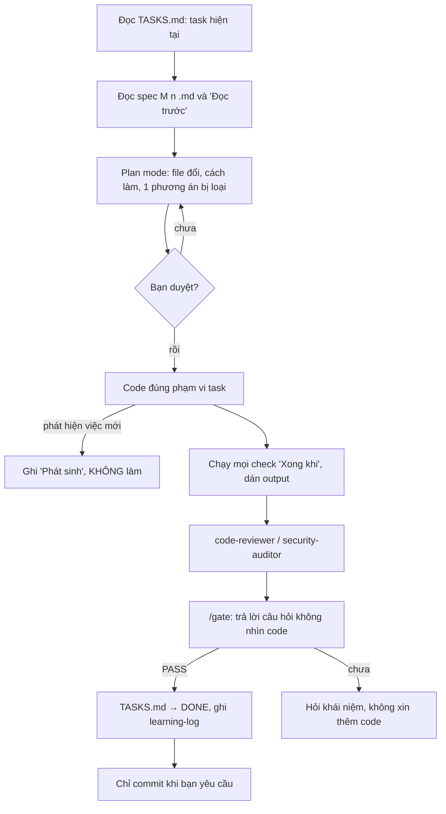


- Bạn chọn task, duyệt kế hoạch, chạy lại ít nhất một lệnh kiểm chứng, đọc diff, trả lời cổng hiểu, quyết định commit.
- Agent lập kế hoạch, viết code, đưa bằng chứng; không tự commit hay push.
- Thay đổi kiến trúc → viết ADR mới; không sửa ADR đã Accepted.
- Một task một nhánh một phiên; `/clear` giữa các task.

