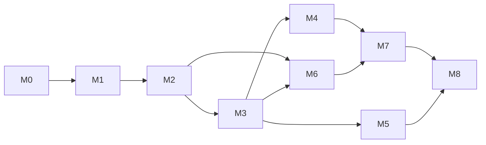

# Lộ trình & Timeline (v2, 12/10/2026)

> Timeline tính theo **giờ làm việc**, quy ra ngày lịch chỉ để tham khảo. Số liệu sinh từ danh sách task (70 task) — sửa task thì tính lại.
> Hiệu chỉnh bắt buộc sau M1: so giờ thực tế với ước tính trong `TASKS.md`, nhân lại hệ số.
> Thay đổi so với v1: xem `CHANGES-2026-10-12.md`.

## 1. Giả định (thay đổi giả định → timeline đổi)

| Giả định | Giá trị | Căn cứ / rủi ro |
|---|---|---|
| Giờ tập trung hiệu quả mỗi ngày | **6 giờ** (trên 8–10 giờ ngồi máy) | Phần còn lại: đọc tài liệu, chờ agent, nghỉ. Giới hạn Claude Code Pro (cửa sổ 5 giờ + giới hạn tuần, dùng chung với chat) có thể là trần thật — đo bằng `/usage` 3 ngày đầu. |
| Ngày làm việc | 6 ngày/tuần, nghỉ Chủ nhật | |
| Cổng hiểu | 20 phút/task | Quy tắc làm việc |
| Cuối mốc | 2 giờ (bài gỡ lỗi + kiểm tra không AI) | |
| Duyệt kế hoạch trước khi code | 1,5 ngày | Đọc toàn bộ docs, sửa chỗ chưa đồng ý |
| Ngày bắt đầu duyệt kế hoạch | Thứ Ba 13/10/2026 | |
| Hệ số | lạc quan ×0,8 · dự kiến ×1,0 · thận trọng ×1,4 | Thận trọng = lỗi môi trường (WSL/Docker), Keycloak/OTel khó cấu hình, Oracle hết máy free, chạm giới hạn Claude |
| Chi phí | **0đ** | Mọi mục tốn tiền nằm ở "Tùy chọn" và cần bạn duyệt |

## 2. Bảng mốc

| Mốc | Kết quả demo được | Task | Giờ (gồm cổng) | Lũy kế | Xong khoảng (lạc quan · dự kiến · thận trọng) |
|---|---|---|---|---|---|
| P | Duyệt kế hoạch | — | 9 | 9 | 14/10 |
| M0 | Môi trường WSL2, monorepo, CI, stack local | 10 | 24,8 | 33,8 | 17/10 · 19/10 · 21/10 |
| M1 | Đăng nhập, tenant, RBAC, vi/en, design baseline | 9 | 32,0 | 65,8 | 22/10 · 24/10 · 30/10 |
| M2 | Upload, danh sách, **lát cắt xuyên suốt bằng XML** | 10 | 32,8 | 98,7 | 28/10 · 31/10 · 09/11 |
| M3 | LLM cho PDF/ảnh + form duyệt | 6 | 21,5 | 120,2 | 31/10 · 05/11 · 14/11 |
| **M4** | **Số đo AI + demo chỉ-xem trên Oracle Always Free → bắt đầu nộp hồ sơ** | 8 | 28,7 | **148,8** | **04/11 · 10/11 · 21/11** |
| M5 | Hỏi đáp RAG có trích dẫn | 7 | 26,3 | 175,2 | 09/11 · 16/11 · 28/11 |
| M6 | Rate limit, 429, cache, realtime | 7 | 24,3 | 199,5 | 12/11 · 20/11 · 05/12 |
| M7 | Observability, bảo mật + giấy phép, CD, backup | 7 | 25,8 | 225,3 | 17/11 · 25/11 · 12/12 |
| M8 | Đóng gói hồ sơ, phỏng vấn thử | 6 | 18,0 | **243,3** | 19/11 · 28/11 · 17/12 |

Tóm lại: **khoảng 4 tuần (dự kiến) tới điểm nộp hồ sơ M4**, khoảng 7 tuần cho toàn bộ; thận trọng thì khoảng 6 và 9,5 tuần. So với v1 tăng ~9,5 giờ (thêm T0.0 môi trường, T1.6b design baseline, T2.9 lát cắt xuyên suốt; deploy Oracle tốn hơn VPS trả phí 1 giờ).

## 3. Đường găng (thứ tự bắt buộc)

- Không làm song song nhiều mốc: một người + một agent, chuyển ngữ cảnh tốn hơn lợi.
- M2 kết thúc khi **một file XML đi trọn luồng** upload → hàng đợi → worker → dịch vụ AI → DB → UI. M3 chỉ thêm nhánh LLM vào luồng đã chạy.
- M5 và M6 có thể đổi thứ tự nếu nhà tuyển dụng mục tiêu quan tâm backend/realtime hơn AI.

## 4. Điểm nộp hồ sơ

Bắt đầu nộp ngay khi xong **M4**: có link demo chỉ-xem (hoặc video nếu Oracle không cấp máy), README, số đo độ chính xác/chi phí, 3 câu phỏng vấn mỗi mốc đã luyện. M5–M8 hoàn thành trong lúc chờ phỏng vấn.

## 5. Phạm vi và cắt giảm khi trễ

| Nhóm | Nội dung |
|---|---|
| Bắt buộc (M0–M4) | Môi trường, monorepo, CI, auth, RLS, RBAC, i18n, design baseline, upload, hàng đợi, lát cắt XML, trích xuất LLM, form duyệt, bộ đánh giá, demo chỉ-xem |
| Bắt buộc (M5–M8) | RAG có trích dẫn, rate limit, xử lý 429, realtime, OTel, bảo mật + giấy phép, CD, backup, README |
| Cắt đầu tiên nếu trễ > 30% | T5.6 rút còn 15 câu; T6.6 chỉ 1 kịch bản; T7.6 chỉ 1 trang; T8.3 video 2 phút |
| Tùy chọn (không tính timeline) | O1 SeaweedFS (0đ) · O2 Azure Container Apps (**có thể tốn tiền, cần duyệt**) · O3 FCM (0đ) · O4 tên miền riêng (**tốn tiền, cần duyệt**) |
| Không làm (ghi chú trade-off để phỏng vấn) | Micro-frontend, Kafka, n8n, LangGraph, Kubernetes, MinIO, proxy kiểu 9Router |

Quy tắc cắt: cắt chiều rộng (ít kịch bản hơn), không cắt chiều sâu của phần đã làm (vẫn phải có test và hiểu); không cắt cách ly tenant, bảo mật, tính đúng dữ liệu, test luồng chính.

## 6. Hiệu chỉnh sau M1

1. Cộng cột "Thực tế (h)" của M0–M1 trong `TASKS.md`.
2. Hệ số mới = thực tế / ước tính. Ví dụ 75h / 56,8h ≈ 1,32.
3. Nhân lại phần còn lại; nếu ngày xong M4 dự kiến trễ quá 3 tuần so với bảng trên → áp dụng bảng cắt giảm ở mục 5.
