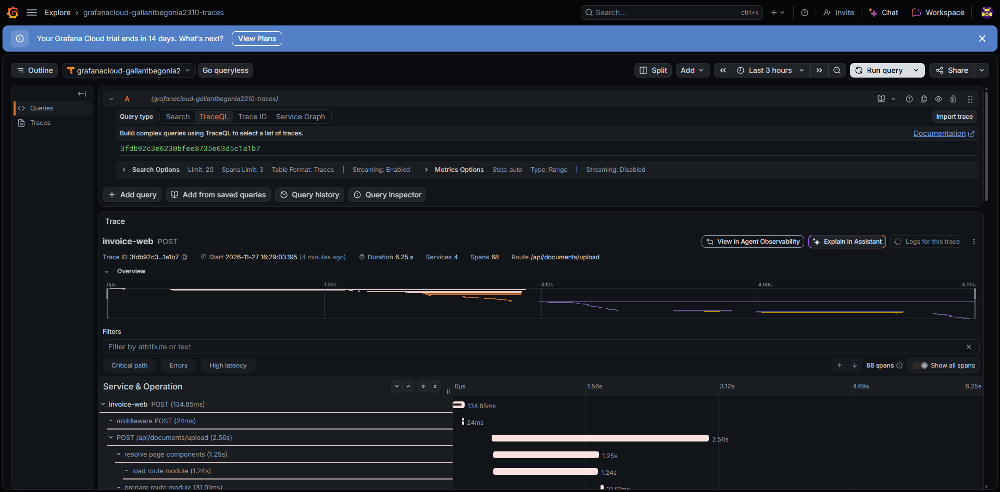
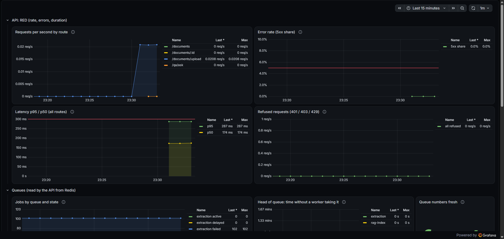
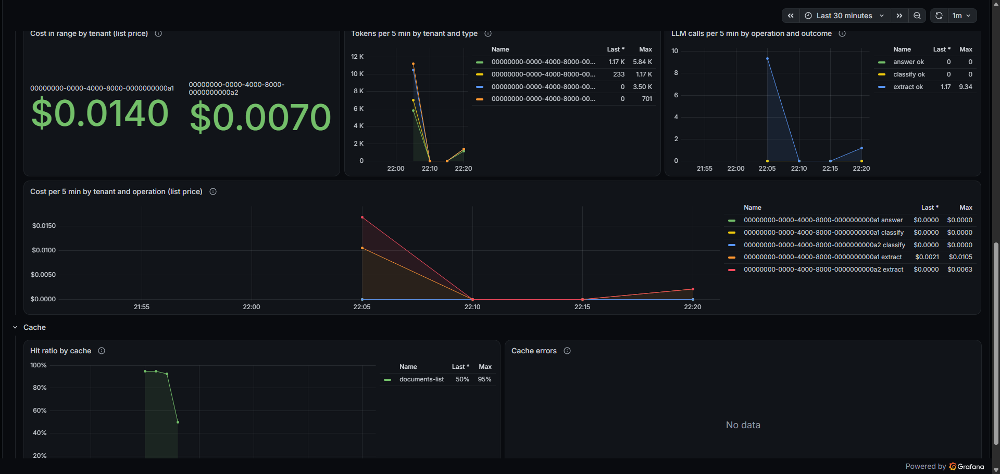
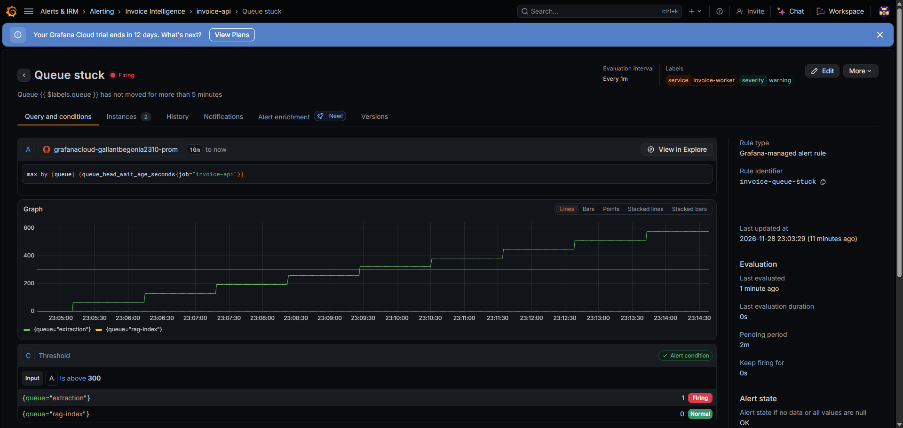
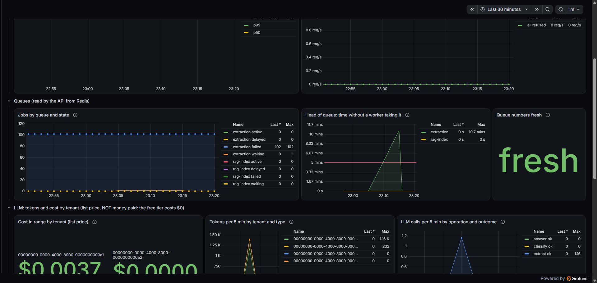

# Tracing, log và metrics với Grafana Cloud (task T7.1, T7.2, T7.3)

> Theo ADR 0015: OpenTelemetry trong cả 4 dịch vụ, xuất OTLP sang Grafana Cloud bản free. Không tự host Grafana.

## Bật/tắt

Tracing **tắt** khi không có biến `OTEL_EXPORTER_OTLP_ENDPOINT`: test, CI và `pnpm dev:stack` bình thường không khởi động SDK nào. Khi có biến, mỗi dịch vụ gửi span với `service.name` riêng:

| Dịch vụ | `service.name` | Code |
|---|---|---|
| Next.js (BFF) | `invoice-web` | `apps/web/src/instrumentation.ts`, `apps/web/src/otel.node.ts` |
| NestJS API | `invoice-api` | `apps/api/src/otel.ts`, `apps/api/src/otel-api.ts` |
| Worker BullMQ | `invoice-worker` | `apps/api/src/otel-worker.ts`, `apps/api/src/common/otel/trace-context.ts` |
| FastAPI AI | `invoice-ai` | `apps/ai/app/otel.py` |
| Dùng chung (Node) | | `packages/telemetry`: provider, propagator, lọc dữ liệu (`RedactingProcessor`) |

## Biến môi trường

Biến chuẩn của OpenTelemetry, cả Node và Python SDK đều tự đọc từ **môi trường của process**:

| Biến | Ví dụ | Ghi chú |
|---|---|---|
| `OTEL_EXPORTER_OTLP_ENDPOINT` | `https://otlp-gateway-prod-<region>.grafana.net/otlp` | SDK tự thêm `/v1/traces` |
| `OTEL_EXPORTER_OTLP_HEADERS` | `Authorization=Basic%20<base64 của instanceId:token>` | **Bí mật.** Dấu cách viết là `%20` |
| `OTEL_EXPORTER_OTLP_PROTOCOL` | `http/protobuf` | Mặc định đã là giá trị này |

API không đọc file env (`ignoreEnvFile`), còn `pydantic-settings` của AI không đẩy biến trong file env vào `os.environ`. Vì vậy đặt các biến trên **trong shell** trước khi chạy stack, không đặt trong file env của từng app.

## Tạo stack Grafana Cloud (một lần)

1. Đăng ký Grafana Cloud bản Free (không cần thẻ). Giới hạn lúc viết: 50 GB trace, 14 ngày lưu, 3 user; kiểm lại trên trang giá trước khi dựa vào.
2. Trong trang quản lý stack: **OpenTelemetry → Configure**. Tạo token (chỉ cần quyền ghi trace), trang sẽ hiện sẵn ba biến ở trên.
3. Lưu ba biến vào một file **ngoài repo**, ví dụ `~/.config/invoice-otel.env`, dạng `export OTEL_EXPORTER_OTLP_ENDPOINT=...`. Không commit, không dán token vào issue hay log.

## Chạy và xem trace

```bash
source ~/.config/invoice-otel.env
LLM_PROVIDER=fake pnpm dev:stack
```

Upload một hoá đơn tổng hợp ở http://localhost:3000, rồi vào Grafana: **Explore → Tempo**, TraceQL:

```text
{ resource.service.name = "invoice-worker" && name = "extraction process" }
```

Mở trace: một lần upload đi qua `invoice-web` (route `/api/documents/upload`) → `invoice-api` (`POST /documents/upload`, Postgres) → `invoice-worker` (span `extraction process`, gọi AI) → `invoice-ai` (`POST /extract`, span `chat <model>` có model và số token).


Trên stack Grafana Cloud mới, dòng "Trial" nghĩa là gói **Cloud Free** đang được dùng thử không giới hạn mức dùng. Hết hạn thử thì mức dùng bị giới hạn theo gói Free, không tự chuyển sang trả phí. Không thêm thẻ, không bấm "Upgrade".

## Trace đi qua hàng đợi như thế nào

API không gửi tiếp header `traceparent` thô: nó lưu `traceparent` của **span đang chạy** vào job data (`activeTraceparent()`), worker đọc lại và mở span `CONSUMER` làm con của span đó (`runInConsumerSpan()`): `extraction process` cho mỗi lần thử, `extraction settle` cho lần ghi `failed` cuối cùng khi job hết lượt thử (BullMQ gọi listener `failed` ngoài span của lần thử, nên phải mở span riêng mới nằm chung trace). Lời gọi `fetch` sang AI được instrumentation undici gắn `traceparent` của worker. Khi tracing bật thì không ai tự set header bằng tay, để không bao giờ có hai header. Khi tracing tắt, worker vẫn chuyển `traceparent` của job sang AI như trước T7.1 (nếu job có).

## Những gì không bao giờ vào span

- Query string: bị cắt khỏi `url.full`, `http.url`, `http.target`; `url.query` thành `REDACTED`.
- Nội dung tài liệu, prompt, câu trả lời của model: span LLM chỉ có tên provider, model, số token, số ảnh, cờ `truncated`.
- Thông báo lỗi, kể cả của thư viện (pg, http, express, undici, FastAPI, httpx): event `exception` bị bỏ, status không có message, chỉ còn `error.type` (mã lỗi hoặc tên lớp lỗi). Node làm ở `RedactingProcessor` (`onEnding`), Python ở `RedactingExporter` (span Python đã khoá khi kết thúc).
- Giá trị tham số SQL (chỉ câu lệnh có tham số của Drizzle).
- Redis/BullMQ không được instrument: worker poll Redis liên tục, sẽ đốt quota free bằng span vô nghĩa.
- Probe `/health`: không có span, kể cả câu `SELECT 1` của `/health/ready` (pg chỉ ghi query nằm trong một request hoặc job đã có span).

## Log có cấu trúc (task T7.2)

Mỗi dịch vụ ghi **một dòng JSON cho mỗi bản ghi** ra stdout. Log không được gửi lên Grafana: không lưu log dài hạn, log chỉ nằm trong `docker logs`. Trên VM demo, mỗi container giữ tối đa 3 file × 10 MB (`infra/prod/compose.prod.yaml`).

| Dịch vụ | Code |
|---|---|
| API, worker | `packages/logger` (pino), nối vào `Logger` của Nest qua `apps/api/src/common/logging/nest-logger.ts`, truyền vào `NestFactory` ở `main.ts`/`worker.ts` |
| AI | `apps/ai/app/logging.py` (structlog, gắn vào root handler của `logging`), gọi trong `create_app()` |
| Web | Chưa có log riêng (code server của web không ghi log) |

Một dòng log trông như sau (worker, trong một job):

```json
{"level":"warn","time":"2026-11-27T09:00:00.000Z","service":"invoice-worker","trace_id":"4bf92f3577b34da6a3ce929d0e0e4736","span_id":"00f067aa0ba902b7","tenant_id":"00000000-0000-4000-8000-0000000000a1","context":"ExtractionWorker","msg":"job 3f… failed (ExtractionJobError)"}
```

- `trace_id`, `span_id`: của span đang chạy. Chỉ có khi tracing bật (có `OTEL_EXPORTER_OTLP_ENDPOINT`).
- `tenant_id`: API và worker lấy từ `TenantDbService.run`, từ job data (`withJobLogContext`), hoặc từ user đã đăng nhập (filter lỗi). AI lấy từ header `X-Tenant-Id` mà API gửi kèm, và bỏ qua nếu header không phải uuid.
- Lỗi: `err` gồm `type`, `message`, `stack`, `code`, trong đó message và stack đã được che.

### Từ một dòng log sang trace

1. Lấy `trace_id` trong dòng log, ví dụ `docker logs invoice-demo-worker-1 | grep '"level":"warn"'`, hoặc đọc trong output của `pnpm dev:stack`.
2. Vào Grafana: **Explore → Tempo**, chọn query type **TraceQL** rồi dán `trace_id` vào ô tìm kiếm, hoặc mở `.../explore` với trace id đó. Trace mở ra đúng lần upload hay câu hỏi đã sinh dòng log.

Kiểm thật ngày 2026-11-27 (`LLM_PROVIDER=fake pnpm dev:stack`, upload `eval/datasets/v1/documents/injection-01.pdf`). Dòng log của AI:

```json
{"level": "info", "logger": "ai.extract", "service": "invoice-ai", "trace_id": "3fdb92c3e6230bfee8735e63d5c1a1b7", "span_id": "4cd13761b876d7c4", "tenant_id": "00000000-0000-4000-8000-0000000000a1", "msg": "llm extract ok model=fake-model attempts=1 in=1000 out=200 ms=48"}
```

Dán trace id đó vào Tempo, ra đúng lần upload: 4 dịch vụ, 68 span, route `/api/documents/upload`.



### Log gì, không log gì

Code chỉ ghi id, mã lỗi, kích thước, thời gian. Không ghi nội dung tài liệu, prompt, câu trả lời, body hay query string (đã có từ T3.6). Không có log truy cập của API: span HTTP đã có method, route, status và thời gian. Request bị từ chối vì 401/403 ghi một dòng `warn` gồm route mẫu, mã lỗi và `user_id`. Từ T7.3, 429 không ghi log nữa (một client vượt giới hạn sẽ sinh một dòng cho mỗi request) mà được đếm bằng metric RED theo route và status. Log truy cập của uvicorn (AI) vẫn còn, và cũng đi qua bộ che.

Bộ che là **lớp thứ hai**, áp lên mọi chuỗi và mọi trường, kể cả log của thư viện:

| Loại | Cách nhận ra | Thay bằng |
|---|---|---|
| Trường có tên `email`, `phone`, `taxCode`/`mst`, `name`, `buyer`, `seller`, `address`, `*Name`, `*Email`… | theo tên khoá | `[REDACTED]` |
| Email | mẫu | `[EMAIL]` |
| MST 10 số, MST chi nhánh 13 số (`0101234567-001` hoặc viết liền), kể cả số điện thoại 10 chữ số viết liền | mẫu, không nằm trong một số dài hơn, số thập phân hay khoảng `1-…`; `MST-0101234567` vẫn bị che | `[TAX_CODE]` |
| Số điện thoại `0…`, `(028) …`, `+84 …`, `84…`, có hoặc không có dấu cách, chấm, gạch | mẫu | `[PHONE]` |
| Tên công ty: `Công ty…`, `Tập đoàn…`, `Doanh nghiệp…`, `… Ltd`, `… and Sons`, `A, B and C Group` | từ chỉ loại hình | `[NAME]` |
| Tên người bắt đầu bằng họ Việt phổ biến (Nguyễn, Trần, Lê…, có dấu hoặc không, viết hoa) | họ + 1–4 từ viết hoa | `[NAME]` |

Chuỗi được chuẩn hoá NFC trước khi che (tên gõ bằng dấu tổ hợp vẫn khớp). Trường truyền qua `logger.child({...})` (Node) cũng bị che. Giới hạn: tên người có họ hiếm, hoặc tên tiếng Anh nằm trong câu tự do ("Keith Anderson"), **không** bị che. Vì vậy quy tắc "không ghi nội dung" vẫn là lớp chính. Node và Python dùng chung bộ case `packages/logger/fixtures/redaction-cases.json`: thêm một mẫu ở bên này mà quên bên kia thì test bên kia đỏ.

## Metrics (task T7.3)

Metric được đẩy bằng OTLP như trace, cùng endpoint, mỗi 60 giây. Bật cùng điều kiện với tracing (có `OTEL_EXPORTER_OTLP_ENDPOINT`). Token phải có quyền `metrics:write`. Dashboard và cảnh báo nằm ở [`infra/grafana/`](../../infra/grafana/README.md).

| Metric (tên OTel → tên trong Grafana) | Loại | Nhãn | Ai ghi, ở đâu |
|---|---|---|---|
| `http.server.request.duration` → `http_server_request_duration_seconds_*` | histogram, 9 bucket (có mốc 0,3 s của NFR-02) | `http_request_method`, `http_route` (route mẫu, ví dụ `/documents/:id`), `http_response_status_code` | API, instrumentation http của T7.1 (`packages/telemetry/src/metrics.ts` giữ đúng 3 nhãn này) |
| `queue.jobs` → `queue_jobs` | gauge | `queue` (`extraction`, `rag-index`), `state` (`waiting`, `active`, `delayed`, `failed`) | API đọc Redis (`apps/api/src/modules/metrics/`) |
| `queue.head_wait.age` → `queue_head_wait_age_seconds` | gauge | `queue` | như trên: cùng một job đã đứng đầu hàng bao lâu (API tự ghi nhớ, `QueueHeads`); 0 khi không có job chờ hoặc đầu hàng vừa đổi |
| `queue.reachable` → `queue_reachable` | gauge | không | 1: lần đọc Redis vừa rồi thành công; 0: thất bại |
| `cache.requests` → `cache_requests_total` | counter | `cache`, `outcome` | API đọc hash `cache:stats` (đếm chung của mọi process) |
| `llm.tokens` → `llm_tokens_total` | counter | `tenant_id`, `operation` (`extract`, `classify`, `answer`), `model`, `token_type` | AI, `TracedLLMProvider` trong `apps/ai/app/otel.py` |
| `llm.cost.list_price_usd` → `llm_cost_list_price_usd_total` | counter | `tenant_id`, `operation`, `model` | như trên, giá từ `apps/ai/app/providers/pricing.py` |
| `llm.calls` → `llm_calls_total` | counter | `tenant_id`, `operation`, `model`, `outcome` (`ok`, `error`) | như trên, tính cả từng lần thử lại |

Grafana Cloud đổi `service.name` thành nhãn `job` (`invoice-api`, `invoice-ai`), dấu chấm thành `_`, và thêm hậu tố theo đơn vị cùng `_total` cho counter ([OTLP format considerations](https://grafana.com/docs/grafana-cloud/send-data/otlp/otlp-format-considerations/)).

Những điểm cần biết:

- **Chi phí LLM là giá niêm yết, không phải tiền đã trả.** Dự án chạy trên free tier nên số tiền thật là $0. `fake-model` có giá bịa trong `pricing.py`, để lần chạy local bằng LLM fake vẫn hiện số trên dashboard.
- **Hàng đợi được đo từ API, không từ worker.** Worker chết chính là lúc hàng đợi ứ đọng, nên process đo phải sống sót.
- **Tuổi đầu hàng là thời gian hàng đợi không tiến, không phải tuổi của job.** BullMQ giữ thời điểm tạo job khi admin retry một job failed, nên tính theo tuổi job thì job failed một tuần trước được retry sẽ trông như đã kẹt một tuần. API ghi nhớ job nào đang đứng đầu, và tuổi chỉ tăng khi lần đọc sau vẫn thấy đúng job đó. Khi API khởi động lại, đồng hồ đếm lại từ 0, nên cảnh báo có thể bật muộn hơn tối đa một ngưỡng (5 phút).
- **Khi Redis không đọc được:** `queue_reachable = 0`. Số job không được ghi, nên SDK (xuất dạng cumulative) lặp lại giá trị cuối. Riêng tuổi đầu hàng vẫn tiếp tục tăng, coi như đầu hàng chưa đổi, nên một job đang kẹt vẫn kích hoạt cảnh báo. Đã kiểm ở `apps/api/test/metrics.int-spec.ts`. Lần thu cuối khi process tắt không ghi gì cả, để không báo nhầm là Redis không đọc được.
- **Worker và web không có metric riêng.** Probe `/health` không được đếm. Histogram HTTP của AI (FastAPI, httpx) và histogram HTTP client của API bị bỏ bằng View, vì RED là của API và mỗi histogram tốn hàng trăm series.
- **Không bao giờ thành nhãn:** đường dẫn thô, query string, id tài liệu hay job, nội dung, câu hỏi. Mỗi nhãn chỉ nhận giá trị từ một tập cố định; riêng `tenant_id` là uuid đã kiểm (sai hoặc thiếu thì là `none`), và số tenant là hữu hạn. Mỗi metric tối đa 500 tổ hợp nhãn (`CARDINALITY_LIMIT`).
- **429 không còn ghi log từng dòng** (từ T7.3); panel "Refused requests" đếm 429 theo route.
- **Lần tăng đầu tiên của một series mới không được tính.** `increase()`/`rate()` lấy mẫu đầu tiên của counter làm mốc. Ví dụ 12 upload xảy ra trước lần export đầu tiên của series `201 /documents/upload` (mỗi 60 s) hiện ra là 0. Từ các lần sau thì đếm đúng, nên trên stack chạy lâu (VM demo) sai lệch này không đáng kể. Kiểm thật ngày 2026-11-28.
- **Panel "per 5 min" có min interval 5 phút.** Metric về mỗi phút một lần, nên `increase` trên cửa sổ ngắn hơn 2 mẫu sẽ không trả gì ("No data").

### Kiểm thật ngày 2026-11-28

`LLM_PROVIDER=fake pnpm dev:stack` gửi metric lên Grafana Cloud. Đã chạy 12 upload PDF tổng hợp cho hai tenant, 6 câu hỏi và 40 lần đọc. Dashboard có số thật:

- **API:** tỉ lệ 5xx 0%. p95 là 97,5 ms ở lần chạy đầu và 287 ms ở lần chụp ảnh (16:30 UTC, có upload). Đây là `pnpm dev:stack` có watcher, không phải số đo NFR-02: số đó đo trên bản build (T6.6, `docs/reports/load-test-v1.md`).
- **LLM theo tenant** (giá niêm yết của `fake-model`, tiền thật là $0): acme khoảng $0,014, globex khoảng $0,007; token tách theo `extract`/`classify`/`answer`.
- **Cache:** tỉ lệ hit của `documents-list` lên tới 95%.

Tổng cộng 96 series, trong đó 50 là bucket của histogram HTTP.





**Kích hoạt thử cảnh báo "Queue stuck".** Worker bị đóng băng bằng `kill -STOP <pid>` (giống một worker bị treo; phải dừng process `node .../dist/worker`, không phải `/bin/sh` bọc ngoài), rồi upload một file. Kết quả trên metric đầu hàng (`queue_head_wait_age_seconds`, sau code-reviewer):

- Job đứng đầu hàng từ 16:04:08 UTC.
- Rule chuyển sang **Firing** lúc 16:11:30 UTC với nhãn `queue=extraction` (đầu hàng đứng yên 576 s, `queue_reachable = 1`).
- Sau `kill -CONT` lúc 16:15:13, job được xử lý ngay; đến 16:20:30 rule đã về **Normal** và tuổi đầu hàng về 0.

Bản đo đầu tiên theo tuổi job (trước khi đổi) cũng bật cảnh báo lúc 15:16:30. Rule "API error rate" ở trạng thái `Normal (NoData)` vì không có 5xx.




