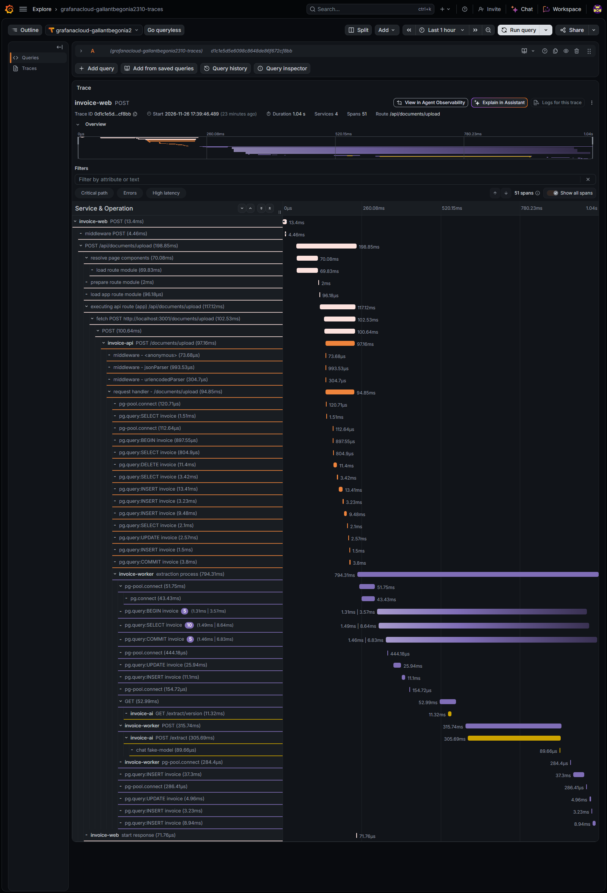

# Tracing và log với Grafana Cloud (task T7.1, T7.2)

> Theo ADR 0015: OpenTelemetry trong cả 4 dịch vụ, xuất OTLP sang Grafana Cloud bản free. Không tự host Grafana.

## Bật/tắt

Tracing **tắt** khi không có biến `OTEL_EXPORTER_OTLP_ENDPOINT`: test, CI và `pnpm dev:stack` bình thường không khởi động SDK nào. Khi có biến, mỗi dịch vụ gửi span với `service.name` riêng:

| Dịch vụ | `service.name` | Code |
|---|---|---|
| Next.js (BFF) | `invoice-web` | `apps/web/src/instrumentation.ts`, `apps/web/src/otel.node.ts` |
| NestJS API | `invoice-api` | `apps/api/src/otel.ts`, `apps/api/src/otel-api.ts` |
| Worker BullMQ | `invoice-worker` | `apps/api/src/otel-worker.ts`, `apps/api/src/common/otel/trace-context.ts` |
| FastAPI AI | `invoice-ai` | `apps/ai/app/otel.py` |
| Dùng chung (Node) | | `packages/telemetry`: provider, propagator, lọc dữ liệu (`RedactingProcessor`) |

## Biến môi trường

Biến chuẩn của OpenTelemetry, cả Node và Python SDK đều tự đọc từ **môi trường của process**:

| Biến | Ví dụ | Ghi chú |
|---|---|---|
| `OTEL_EXPORTER_OTLP_ENDPOINT` | `https://otlp-gateway-prod-<region>.grafana.net/otlp` | SDK tự thêm `/v1/traces` |
| `OTEL_EXPORTER_OTLP_HEADERS` | `Authorization=Basic%20<base64 của instanceId:token>` | **Bí mật.** Dấu cách viết là `%20` |
| `OTEL_EXPORTER_OTLP_PROTOCOL` | `http/protobuf` | Mặc định đã là giá trị này |

API không đọc file env (`ignoreEnvFile`), còn `pydantic-settings` của AI không đẩy biến trong file env vào `os.environ`. Vì vậy đặt các biến trên **trong shell** trước khi chạy stack, không đặt trong file env của từng app.

## Tạo stack Grafana Cloud (một lần)

1. Đăng ký Grafana Cloud bản Free (không cần thẻ). Giới hạn lúc viết: 50 GB trace, 14 ngày lưu, 3 user; kiểm lại trên trang giá trước khi dựa vào.
2. Trong trang quản lý stack: **OpenTelemetry → Configure**. Tạo token (chỉ cần quyền ghi trace), trang sẽ hiện sẵn ba biến ở trên.
3. Lưu ba biến vào một file **ngoài repo**, ví dụ `~/.config/invoice-otel.env`, dạng `export OTEL_EXPORTER_OTLP_ENDPOINT=...`. Không commit, không dán token vào issue hay log.

## Chạy và xem trace

```bash
source ~/.config/invoice-otel.env
LLM_PROVIDER=fake pnpm dev:stack
```

Upload một hoá đơn tổng hợp ở http://localhost:3000, rồi vào Grafana: **Explore → Tempo**, TraceQL:

```text
{ resource.service.name = "invoice-worker" && name = "extraction process" }
```

Mở trace: một lần upload đi qua `invoice-web` (route `/api/documents/upload`) → `invoice-api` (`POST /documents/upload`, Postgres) → `invoice-worker` (span `extraction process`, gọi AI) → `invoice-ai` (`POST /extract`, span `chat <model>` có model và số token).



Trên stack Grafana Cloud mới, dòng "Trial" nghĩa là gói **Cloud Free** đang được dùng thử không giới hạn mức dùng. Hết hạn thử thì mức dùng bị giới hạn theo gói Free, không tự chuyển sang trả phí. Không thêm thẻ, không bấm "Upgrade".

## Trace đi qua hàng đợi như thế nào

API không gửi tiếp header `traceparent` thô: nó lưu `traceparent` của **span đang chạy** vào job data (`activeTraceparent()`), worker đọc lại và mở span `CONSUMER` làm con của span đó (`runInConsumerSpan()`): `extraction process` cho mỗi lần thử, `extraction settle` cho lần ghi `failed` cuối cùng khi job hết lượt thử (BullMQ gọi listener `failed` ngoài span của lần thử, nên phải mở span riêng mới nằm chung trace). Lời gọi `fetch` sang AI được instrumentation undici gắn `traceparent` của worker. Khi tracing bật thì không ai tự set header bằng tay, để không bao giờ có hai header. Khi tracing tắt, worker vẫn chuyển `traceparent` của job sang AI như trước T7.1 (nếu job có).

## Những gì không bao giờ vào span

- Query string: bị cắt khỏi `url.full`, `http.url`, `http.target`; `url.query` thành `REDACTED`.
- Nội dung tài liệu, prompt, câu trả lời của model: span LLM chỉ có tên provider, model, số token, số ảnh, cờ `truncated`.
- Thông báo lỗi, kể cả của thư viện (pg, http, express, undici, FastAPI, httpx): event `exception` bị bỏ, status không có message, chỉ còn `error.type` (mã lỗi hoặc tên lớp lỗi). Node làm ở `RedactingProcessor` (`onEnding`), Python ở `RedactingExporter` (span Python đã khoá khi kết thúc).
- Giá trị tham số SQL (chỉ câu lệnh có tham số của Drizzle).
- Redis/BullMQ không được instrument: worker poll Redis liên tục, sẽ đốt quota free bằng span vô nghĩa.
- Probe `/health`: không có span, kể cả câu `SELECT 1` của `/health/ready` (pg chỉ ghi query nằm trong một request hoặc job đã có span).

## Log có cấu trúc (task T7.2)

Mỗi dịch vụ ghi **một dòng JSON cho mỗi bản ghi** ra stdout. Log không được gửi lên Grafana: không lưu log dài hạn, log chỉ nằm trong `docker logs`. Trên VM demo, mỗi container giữ tối đa 3 file × 10 MB (`infra/prod/compose.prod.yaml`).

| Dịch vụ | Code |
|---|---|
| API, worker | `packages/logger` (pino), nối vào `Logger` của Nest qua `apps/api/src/common/logging/nest-logger.ts`, truyền vào `NestFactory` ở `main.ts`/`worker.ts` |
| AI | `apps/ai/app/logging.py` (structlog, gắn vào root handler của `logging`), gọi trong `create_app()` |
| Web | Chưa có log riêng (code server của web không ghi log) |

Một dòng log trông như sau (worker, trong một job):

```json
{"level":"warn","time":"2026-11-27T09:00:00.000Z","service":"invoice-worker","trace_id":"4bf92f3577b34da6a3ce929d0e0e4736","span_id":"00f067aa0ba902b7","tenant_id":"00000000-0000-4000-8000-0000000000a1","context":"ExtractionWorker","msg":"job 3f… failed (ExtractionJobError)"}
```

- `trace_id`, `span_id`: của span đang chạy. Chỉ có khi tracing bật (có `OTEL_EXPORTER_OTLP_ENDPOINT`).
- `tenant_id`: API và worker lấy từ `TenantDbService.run`, từ job data (`withJobLogContext`), hoặc từ user đã đăng nhập (filter lỗi). AI lấy từ header `X-Tenant-Id` mà API gửi kèm, và bỏ qua nếu header không phải uuid.
- Lỗi: `err` gồm `type`, `message`, `stack`, `code`, trong đó message và stack đã được che.

### Từ một dòng log sang trace

1. Lấy `trace_id` trong dòng log, ví dụ `docker logs invoice-demo-worker-1 | grep '"level":"warn"'`, hoặc đọc trong output của `pnpm dev:stack`.
2. Vào Grafana: **Explore → Tempo**, chọn query type **TraceQL** rồi dán `trace_id` vào ô tìm kiếm, hoặc mở `.../explore` với trace id đó. Trace mở ra đúng lần upload hay câu hỏi đã sinh dòng log.

Kiểm thật ngày 2026-11-27 (`LLM_PROVIDER=fake pnpm dev:stack`, upload `eval/datasets/v1/documents/injection-01.pdf`). Dòng log của AI:

```json
{"level": "info", "logger": "ai.extract", "service": "invoice-ai", "trace_id": "3fdb92c3e6230bfee8735e63d5c1a1b7", "span_id": "4cd13761b876d7c4", "tenant_id": "00000000-0000-4000-8000-0000000000a1", "msg": "llm extract ok model=fake-model attempts=1 in=1000 out=200 ms=48"}
```

Dán trace id đó vào Tempo, ra đúng lần upload: 4 dịch vụ, 68 span, route `/api/documents/upload`.


### Log gì, không log gì

Code chỉ ghi id, mã lỗi, kích thước, thời gian. Không ghi nội dung tài liệu, prompt, câu trả lời, body hay query string (đã có từ T3.6). Không có log truy cập của API: span HTTP đã có method, route, status và thời gian. Request bị từ chối (401/403/429) ghi một dòng `warn` gồm route mẫu, mã lỗi và `user_id`. Log truy cập của uvicorn (AI) vẫn còn, và cũng đi qua bộ che.

Bộ che là **lớp thứ hai**, áp lên mọi chuỗi và mọi trường, kể cả log của thư viện:

| Loại | Cách nhận ra | Thay bằng |
|---|---|---|
| Trường có tên `email`, `phone`, `taxCode`/`mst`, `name`, `buyer`, `seller`, `address`, `*Name`, `*Email`… | theo tên khoá | `[REDACTED]` |
| Email | mẫu | `[EMAIL]` |
| MST 10 số, MST chi nhánh 13 số (`0101234567-001` hoặc viết liền), kể cả số điện thoại 10 chữ số viết liền | mẫu, không nằm trong một số dài hơn, số thập phân hay khoảng `1-…`; `MST-0101234567` vẫn bị che | `[TAX_CODE]` |
| Số điện thoại `0…`, `(028) …`, `+84 …`, `84…`, có hoặc không có dấu cách, chấm, gạch | mẫu | `[PHONE]` |
| Tên công ty: `Công ty…`, `Tập đoàn…`, `Doanh nghiệp…`, `… Ltd`, `… and Sons`, `A, B and C Group` | từ chỉ loại hình | `[NAME]` |
| Tên người bắt đầu bằng họ Việt phổ biến (Nguyễn, Trần, Lê…, có dấu hoặc không, viết hoa) | họ + 1–4 từ viết hoa | `[NAME]` |

Chuỗi được chuẩn hoá NFC trước khi che (tên gõ bằng dấu tổ hợp vẫn khớp). Trường truyền qua `logger.child({...})` (Node) cũng bị che. Giới hạn: tên người có họ hiếm, hoặc tên tiếng Anh nằm trong câu tự do ("Keith Anderson"), **không** bị che. Vì vậy quy tắc "không ghi nội dung" vẫn là lớp chính. Node và Python dùng chung bộ case `packages/logger/fixtures/redaction-cases.json`: thêm một mẫu ở bên này mà quên bên kia thì test bên kia đỏ.
