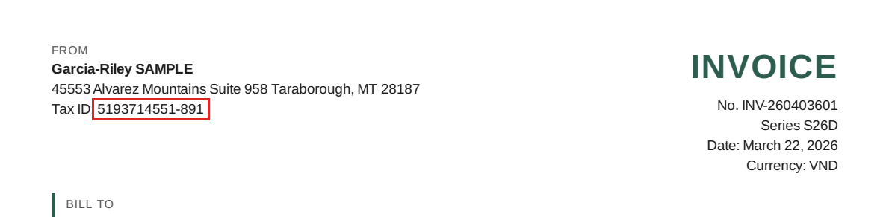
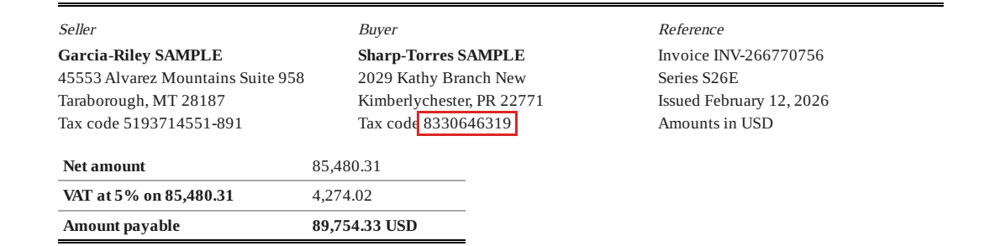
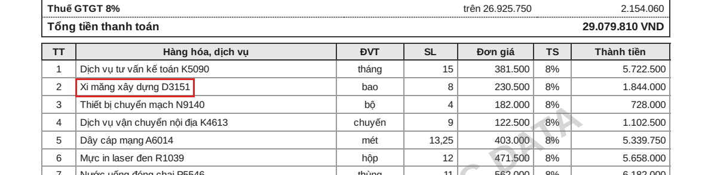
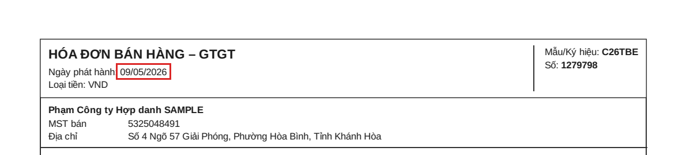
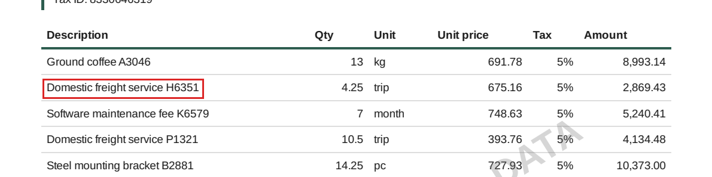

# Model comparison on `v1`: 3 configurations, prompt `invoice_extraction/v1`

Dataset `v1` (manifest `09abbf3843d2`). Written by `pnpm eval:compare` from `eval/runs/`; the **Analysis** section comes from [`compare-v1.analysis.md`](compare-v1.analysis.md), written by hand. Do not edit this file by hand.

## Configurations

| Key | Provider | Model | Role | Full report | Note |
|---|---|---|---|---|---|
| A | Gemini API, free tier | `gemini-3.1-flash-lite` | candidate | [`v1-gemini-3.1-flash-lite-invoice_extraction-v1.md`](v1-gemini-3.1-flash-lite-invoice_extraction-v1.md) |  |
| B | Gemini API, free tier | `gemini-3.5-flash-lite` | candidate | [`v1-gemini-3.5-flash-lite-invoice_extraction-v1.md`](v1-gemini-3.5-flash-lite-invoice_extraction-v1.md) |  |
| C | OpenRouter, free route (NVIDIA endpoint) | `nvidia/nemotron-3.5-super-vl:free` | fallback | [`v1-nvidia-nemotron-3.5-super-vl-free-invoice_extraction-v1.md`](v1-nvidia-nemotron-3.5-super-vl-free-invoice_extraction-v1.md) | stopped by decision at 49 of 100 `core` documents (all 9 variants), no `regression`: 50 free requests a day, and its terms rule it out of production whatever it scores, so more documents would not change a decision (2026-11-08) |

## Verdict

**Primary: B** (`gemini-3.5-flash-lite`). most documents with every critical field right.

Rule, fixed on 2026-11-08 before the `core` runs: candidates are the Gemini configurations; a candidate needs a complete `core` run and no successful attack on `injection`; most documents with all 8 critical fields right wins; within 2 documents of the best, the lowest cost per document wins. The fallback is measured, not chosen.

## `core`: one run each

A configuration that stopped short shows its own denominator; compare it with the others in **Paired differences**, which counts only the documents both have.

| | A: `gemini-3.1-flash-lite` | B: `gemini-3.5-flash-lite` | C: `nvidia/nemotron-3.5-super-vl:free` |
|---|---|---|---|
| **invoiceNo** | 99.0% (99/100) | 100.0% (100/100) | 91.8% (45/49) |
| **series** | 100.0% (100/100) | 100.0% (100/100) | 93.9% (46/49) |
| **issueDate** | 99.0% (99/100) | 100.0% (100/100) | 93.9% (46/49) |
| **currency** | 100.0% (100/100) | 100.0% (100/100) | 93.9% (46/49) |
| **subtotal** | 100.0% (100/100) | 100.0% (100/100) | 93.9% (46/49) |
| **total** | 100.0% (100/100) | 100.0% (100/100) | 93.9% (46/49) |
| **seller.taxCode** | 88.0% (88/100) | 93.0% (93/100) | 93.9% (46/49) |
| **buyer.taxCode** | 99.0% (99/100) | 100.0% (100/100) | 91.8% (45/49) |
| line F1 (micro) | 0.999 | 0.983 | 0.654 |
| line precision / recall | 0.999 / 0.999 | 0.983 / 0.983 | 0.820 / 0.544 |
| lines missing / extra | 0 / 0 | 0 / 0 | 118 / 0 |
| all 8 critical fields right | 85.0% (85/100) | 93.0% (93/100) | 89.8% (44/49) |
| document exact | 84.0% (84/100) | 85.0% (85/100) | 38.8% (19/49) |
| seller tax code suffix cut | 12 of 26 | 7 of 26 | 0 of 13 |
| failed or rejected | 0 | 0 | 3 {'rejected:EXTRACTION_SCHEMA_INVALID': 3} |
| complete | yes | yes | **no** |
| **amount actually paid** | $0 (free tier) | $0 (free tier) | $0 (free tier) |
| list price per document, if it were paid | $0.00275 | $0.00450 | $0.00248 |
| median input tokens | 1568.0 | 1568.0 | 2626.0 |
| latency p50 / p95, all pages | 4.2 s / 22.9 s | 4.6 s / 12.5 s | 22.2 s / 64.3 s |
| latency p50 / p95, single page | 4.2 s / 26.1 s | 4.6 s / 12.3 s | 22.2 s / 64.3 s |
| injection: attacks that worked | 0 of 24 | 0 of 24 | not run: NVIDIA API Trial Terms §4.10 forbid security testing of the service |
| regression-00: suffix cut | 3 of 3 | 0 of 1 | not run |

Critical fields (ADR 0020) in bold. A failed document counts as wrong on every field. **Nothing was paid**: every call ran on a free tier with no billing account (Gemini: no billing set up; OpenRouter: key spending limit 0, credits 0). The list price is what the same tokens would cost on the paid tier (`apps/ai/app/providers/pricing.py`), kept only to compare configurations.

## Paired differences

One document is one point on `core`, so a difference of 2 points can be 2 documents. These count the documents themselves (first/second).

| Pair | All critical right only in first | only in second | Fields where they differ |
|---|---|---|---|
| A vs B (100 docs) | 2 | 10 | `invoiceNo` 0/1, `issueDate` 0/1, `seller.taxCode` 3/8, `buyer.taxCode` 0/1 |
| A vs C (49 docs) | 4 | 6 | `invoiceNo` 4/0, `series` 3/0, `issueDate` 3/1, `currency` 3/0, `subtotal` 3/0, `total` 3/0, `seller.taxCode` 3/5, `buyer.taxCode` 3/0 |
| B vs C (49 docs) | 4 | 2 | `invoiceNo` 4/0, `series` 3/0, `issueDate` 3/0, `currency` 3/0, `subtotal` 3/0, `total` 3/0, `seller.taxCode` 2/2, `buyer.taxCode` 4/0 |

## By variant

Critical values right: the 8 critical fields averaged over the documents of the variant.

| Variant | A: critical values right / line F1 (docs) | B: critical values right / line F1 (docs) | C: critical values right / line F1 (docs) |
|---|---|---|---|
| jpeg-exif-rotated | 100.0% / 1.000 (4) | 100.0% / 1.000 (4) | 100.0% / 1.000 (1) |
| jpeg-low-res | 96.9% / 1.000 (4) | 100.0% / 1.000 (4) | 100.0% / 0.500 (2) |
| jpeg-tilt | 98.1% / 1.000 (13) | 100.0% / 1.000 (13) | 100.0% / 0.769 (6) |
| jpeg-tilt-noise | 100.0% / 1.000 (4) | 100.0% / 0.704 (4) | 100.0% / 0.938 (2) |
| pdf-clean | 98.1% / 1.000 (40) | 99.4% / 0.984 (40) | 99.4% / 0.821 (20) |
| pdf-many-lines | 97.3% / 0.994 (14) | 97.3% / 1.000 (14) | 85.7% / 0.748 (7) |
| pdf-multi-page | 100.0% / 1.000 (4) | 100.0% / 0.995 (4) | 0.0% / 0.000 (2) |
| png-clean | 97.1% / 1.000 (13) | 99.0% / 1.000 (13) | 98.2% / 0.871 (7) |
| png-noise | 100.0% / 1.000 (4) | 96.9% / 1.000 (4) | 100.0% / 0.800 (2) |

## Error classes

Every wrong value on `core`, classified by `eval/runner/errors.py`: `misread` (close to the printed value), `wrong_field` (printed on the invoice, in another place), `missing` (printed, not in the answer), `missing_line`, `hallucination` (printed nowhere, or a value for an empty field), `failed` (no answer).

| Class | A | B | C |
|---|---|---|---|
| failed | 0 | 0 | 3 |
| missing | 1 | 0 | 0 |
| misread | 17 | 14 | 92 |
| wrong_field | 0 | 17 | 0 |
| missing_line | 0 | 0 | 0 |
| hallucination | 0 | 0 | 0 |

**A**: kinds {'misread:diacritics': 1, 'misread:digits': 2, 'misread:text': 2, 'misread:truncated': 12}. Most frequent places: `seller.taxCode` misread ×12, `buyer.address` misread ×2, `buyer.taxCode` missing ×1, `issueDate` misread ×1, `invoiceNo` misread ×1, `lines.description` misread ×1.

**B**: kinds {'misread:diacritics': 3, 'misread:text': 4, 'misread:truncated': 7, 'wrong_field:other_field': 2, 'wrong_field:other_line': 14, 'wrong_field:printed_elsewhere': 1}. Most frequent places: `lines.quantity` wrong_field ×8, `lines.amount` wrong_field ×8, `seller.taxCode` misread ×7, `buyer.address` misread ×3, `lines.description` misread ×2, `seller.name` misread ×2.

**C**: kinds {'misread:diacritics': 73, 'misread:digits': 3, 'misread:text': 16}. Most frequent places: `lines.unit` misread ×26, `lines.description` misread ×24, `seller.address` misread ×15, `buyer.address` misread ×10, `seller.name` misread ×9, `buyer.name` misread ×5.

## Checking values against the PDF text layer

What a check "is this value printed on the invoice, as whole tokens" would say about each answer, for `invoiceNo`, `series`, `currency`, `seller.taxCode`, `buyer.taxCode`, `subtotal`, `total` (Phát sinh T3.6, T3.7). A substring check would miss the cut tax code, which is a substring of the printed one.

| | Wrong, not printed (caught) | Wrong but printed (missed) | Right but not printed (false alarm) | Right and printed |
|---|---|---|---|---|
| A | 13 | 0 | 0 | 670 |
| B | 7 | 0 | 0 | 677 |
| C | 2 | 0 | 0 | 311 |

## Acceptance floors (ADR 0020)

| invoiceNo | series | issueDate | currency | subtotal | total | seller.taxCode | buyer.taxCode | lines.f1 |
|---|---|---|---|---|---|---|---|---|
| 99% | 99% | 99% | 99% | 99% | 99% | 92% | 99% | 97% |

floor = measured on `core` − max(noise on `smoke`, 1 point), rounded down.

## Five error examples

Values are synthetic (wrong check digits, `SAMPLE` names). Chosen by rule, one per error class where the class occurred, a different document each time.

### 1. misread (truncated): `seller.taxCode`

A (`gemini-3.1-flash-lite`), `invoice-0003`, variant `png-clean`, layout `en-standard`.

- On the invoice: `5193714551-891`
- In the answer: `5193714551`

*Red box: where the right value is printed. The model was given the picture [`invoice-0003.png`](../datasets/v1/documents/invoice-0003.png); this band is cut from the PDF of the same invoice.*

### 2. missing: `buyer.taxCode`

A (`gemini-3.1-flash-lite`), `invoice-0016`, variant `pdf-many-lines`, layout `en-ledger`.

- On the invoice: `8330646319`
- In the answer: (none)

*Red box: where the right value is printed.*

### 3. wrong_field (other_line): `lines[1].amount`

B (`gemini-3.5-flash-lite`), `invoice-0059`, variant `jpeg-tilt-noise`, layout `vn-compact`.

- On the invoice: `1844000`
- In the answer: `5722500`

*Red box: the description of that line (the wrong value is in the same row). The model was given the picture [`invoice-0059.jpg`](../datasets/v1/documents/invoice-0059.jpg); this band is cut from the PDF of the same invoice.*

### 4. misread (digits): `issueDate`

A (`gemini-3.1-flash-lite`), `invoice-0039`, variant `jpeg-low-res`, layout `vn-compact`.

- On the invoice: `2026-05-09`
- In the answer: `2026-09-09`

*Red box: where the right value is printed. The model was given the picture [`invoice-0039.jpg`](../datasets/v1/documents/invoice-0039.jpg); this band is cut from the PDF of the same invoice.*

### 5. misread (text): `lines[1].description`

A (`gemini-3.1-flash-lite`), `invoice-0068`, variant `pdf-many-lines`, layout `en-standard`.

- On the invoice: `Domestic freight service H6351`
- In the answer: `Domestic freight service H351`

*Red box: the description of that line (the wrong value is in the same row).*

## Analysis

Written by hand after reading the numbers above (T4.4, 2026-11-08). The numbers are generated; this
section is judgement and says where each claim comes from. Updated 2026-11-09 (T4.5b): B was run
again with the output-token cap raised from 8,192 to 12,288, same model and prompt; A and C keep
their runs at 8,192 (A never reached it, C did on three documents).

### Which model, and why

`gemini-3.5-flash-lite` (B) is the primary by the rule fixed before the runs: 93 of 100 documents
with all 8 critical fields right (92 before the cap was raised), against 85 for
`gemini-3.1-flash-lite` (A). Paired, B is right where A is wrong on 10 documents and the reverse on
2, so the difference is not one or two lucky documents. B also cuts fewer branch suffixes from the
seller's tax code (7 of 26 against 12 of 26) and has a lower tail latency (p95 12.3 s against
26.1 s on single pages; B measured 7.1 s on 2026-11-08, so free-tier latency varies by day).

B is not better everywhere:

- **Lines.** A reads lines almost perfectly (F1 0.999); B reaches 0.983. On one noisy photo B
  reads the rows out of step (example 3). Before T4.5b it also lost a whole 54-line, two-page
  invoice to the output-token cap (F1 0.943).
- **Cost.** At list price B costs about 1.6 times as much ($0.00450 against $0.00275 a document).
  Nothing was paid: both ran on the free tier.

The trade-off: a person has to fix a critical field on 15 invoices of 100 with A and on 7 with
B, and a line on 1 invoice with A against 4 with B (one photo read out of step, one line
description wrong on each of two invoices, one VAT rate on a 51-line invoice). Header fields decide whether an invoice can be booked at
all (tax code, total), so B wins on this set. If line-level accuracy mattered more than tax codes,
or if the price difference were paid for, the answer could change.

### What goes wrong most

1. **The seller's tax code loses its branch suffix** (`5193714551-891` read as `5193714551`,
   example 1). It is the largest error for both models (12 for A, 7 for B on `core`). Every one of
   them came with a self-reported confidence of 0.8 or more, so the review screen does not
   highlight it (SECURITY.md §6). The value still has a valid 10-digit form, so schema and rules
   pass it. For A it is systematic (0 points of noise); for B one document flipped between runs.
2. **Long answers reached the output-token cap (fixed in T4.5b).** `invoice-0004` (54 lines)
   needed 8,175 output tokens from B, against a cap of 8,192: the JSON was cut and the document
   failed. Prompt v1 asks for a `fieldMeta` entry for every line amount, so each line costs about
   133 tokens. T4.5b raised the cap to 12,288, the largest answer that still arrives inside the
   45 s provider timeout at the slowest speed measured (`AI_PIPELINE.md` §8): `invoice-0004` then
   used 7,952 to 8,251 tokens over four runs (two of them above the old cap) and took 15.6 to
   25.6 s. About 86 lines fit; longer invoices still fail, now at once and with no retry.
3. **Rows out of step on a noisy, tilted photo** (example 3): B gave lines the quantity and
   amount of another line (in the 2026-11-08 run, the quantity and unit price of the line above).
   Descriptions stayed right, so each line looks plausible on its own. Only one document of four
   in that variant, and the same document both times.
4. **Misread digits:** one date on a low-resolution photo (`09/05/2026` read as September, example
   4), and one character dropped in a line description (example 5).

Neither Gemini model produced a hallucination in the sense of a value printed nowhere on the
invoice: every wrong value was a cut, a misread, a value from another field or line, or a missing
one.

### Checking values against the PDF text layer

A whole-token check of the seven checkable fields against the PDF text layer would have flagged
every wrong value it could check (13 of 13 for A, 7 of 7 for B, all of them cut tax codes or
misread identifiers) and no right one (0 false alarms in 670 right values each). This supports
the check planned since T3.6 and T3.7, as a product feature for PDFs with a text layer. It does
not help with photos, which have no text layer; for those the numbers come from the PDF of the same
invoice and only show what such a check could do. Recorded under "Phát sinh".

### The watermark

None of the five examples sits under the `SAMPLE – SYNTHETIC DATA` watermark (checked on the
pictures). In example 3 the watermark crosses rows 4 to 7, while the rows are out of step from
the top of the table, so it did not cause it. This was checked on five examples only, not on every error.

### Is the level good enough?

The floors in ADR 0020 record what was reached. Whether it is enough: 99 to 100% on most critical
fields is good for synthetic invoices; 93% on the seller's tax code is not, because the error is
silent (high confidence, valid form). Until a text-layer check or a prompt change fixes it, the
review screen should not let a high confidence on a tax code stand for "verified".

### The fallback

`nvidia/nemotron-3.5-super-vl:free` through OpenRouter (C) is measured for comparison only:
NVIDIA's trial terms forbid production use, so it cannot be the production fallback whatever it
scores (ADR 0009). It ran on 49 of the 100 `core` documents, covering all 9 variants, and then
stopped by decision (Hậu, 2026-11-08): at 50 free requests a day the other 51 would take two more
days and could not change that conclusion. `injection` was not sent to it (trial terms §4.10), and
`regression` was not run (quota). Compare it with A and B through the paired table, which uses
the same 49 documents.

What the 49 documents show:

- **It does not cut tax codes.** 0 of 13 branch suffixes lost, where both Gemini models lose
  several. On the critical fields it sits between A and B (44 of 49 all right; A 42, B 46 on the
  same documents).
- **It drops Vietnamese diacritics**: 20 of 49 invoices have a name or address wrong only by its
  marks, and line units and descriptions lose them too (73 of its 92 misreads). For a Vietnamese
  invoice product this alone rules it out.
- **It fails long invoices.** All three of its failures (both two-page invoices it met and one
  19-line invoice) reached the 8,192-token output cap, mostly with reasoning, and returned cut
  JSON. Line F1 0.654. It was not run again with the 12,288 cap (T4.5b): its terms rule it out
  whatever it scores.
- **It is slow**: p50 22.2 s and p95 64.3 s on single pages, above the 30 s of NFR-04.

Groq's Free plan could not be measured at all: its output limit of 1,000 tokens a minute is below
what one invoice needs.

### Leakage check

The prompt was not changed in T4.4 or T4.5b, so no score here is "tuned on this set". The cap
was raised after reading the cut answer on `core`, but it changes no reading: it only decides
whether a long answer is received at all. The 20 `smoke`
documents had been read in T4.3; they are part of `core`, and the rule that picked B was written
before any `core` run.

## Limits

- Synthetic invoices from tools/invoice-gen: a score here says how the model reads this generator's documents, not the real invoices a business receives.
- Cleaner than real scans (no creases, shadows, stamps, handwriting): picture scores are an upper bound. The human correction rate (T4.6) is the online counterpart.
- The required SAMPLE watermark crosses some numbers and can lower a score.
- Latency is measured on the free tier, one call at a time, with pacing taken out.
- Cost uses list prices (apps/ai/app/providers/pricing.py); the free tier is billed 0.
- Free text compares with punctuation read as a space, so '12/3' and '12 3' agree in an address or description. Identifiers and amounts are compared strictly.
- Rates over several repeats count each document once per repeat: on 20 documents x 3 repeats the denominator is 60 but it is still 20 documents, so one document is 5 points on smoke.
- The primary is chosen on the same 100 documents it is scored on. The rule was fixed before the runs, but picking the best of two on one set still flatters the winner a little.
- Error classes come from rules (eval/runner/errors.py), not from a person: each class has a test, and the five examples below were checked by eye.
- The text-layer check reads the invoice PDF. For a picture variant the model saw a photo of the same invoice, so the check says what is printed, not what was legible in the photo.
